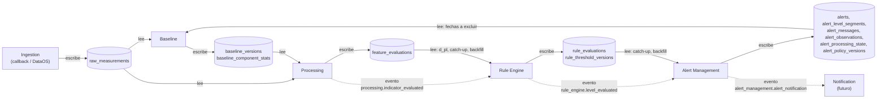
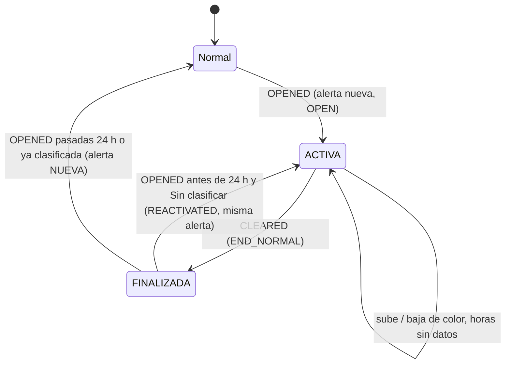

# Flujo: Rule Engine, Alert Management y sus conexiones

Cómo viaja una medición hasta convertirse en una alerta gestionada: qué hace cada módulo, por dónde se comunica (eventos del bus o lectura directa de tablas), en qué minuto de cada hora corre cada proceso, y qué pasa cuando algo falla.

Referencias de detalle: `internal/modules/rule_engine/RULE_ENGINE_README.MD`, `internal/modules/alert_management/ALERT_MANAGEMENT_README.MD`, `internal/modules/alert_management/ALERT_MANAGEMENT_API.MD` y `ARQUITECTURA_LITE.md`.

---

## 1. La cadena completa



Líneas continuas: lectura o escritura de tablas. Líneas punteadas: eventos del bus.

Cada módulo tiene **una sola responsabilidad**:

| Módulo | Verbo | Responde |
|---|---|---|
| Processing | **mide** | ¿Cuánto vale el índice I de esta ventana de 24 h? |
| Rule Engine | **interpreta** | Con esos valores y los umbrales del punto, ¿qué nivel tiene esta hora? ¿Abrió o cerró un episodio? |
| Alert Management | **gestiona** | ¿Hay que crear una alerta, continuarla, subirla, bajarla, reactivarla o cerrarla? ¿Qué mensaje se emite? ¿Qué decidió el operador? |
| Notification (futuro) | **entrega** | ¿Por qué canal y a quién llega el aviso? |

Ninguno invade al siguiente: Processing no sabe de umbrales, el Rule Engine no sabe de alertas ni de clasificaciones, y Alert Management no entrega avisos ni recalcula niveles.

---

## 2. Mapa de conexiones

Toda conexión entre módulos es de uno de estos dos tipos. **Ningún módulo importa el código de otro** (lo prohíbe `depguard` en `.golangci.yml`).

| De → a | Mecanismo | Qué viaja o qué se lee | Para qué |
|---|---|---|---|
| Processing → Rule Engine | **Evento** `processing.indicator_evaluated` | I de cada ventana (24 h y 6 h) recién guardada | Interpretar la hora en vivo |
| Rule Engine ← Processing | **Lectura** de `feature_evaluations` | `d_pl` de la hora; horas `CALCULATED` de 24 h | `d_pl` (el evento no lo trae), catch-up y backfill |
| Rule Engine ← Ingestion | **Lectura** de `devices` y `raw_measurements` | Puntos y primera medición de cada uno | Seed inicial de umbrales (v1 desde la primera medición) |
| Rule Engine → Alert Management | **Evento** `rule_engine.level_evaluated` (v3) | Nivel interpretado de **cada** hora de 24 h | Gestionar la alerta en vivo |
| Alert Management ← Rule Engine | **Lectura** de `rule_evaluations` + `rule_threshold_versions` | Horas ya interpretadas, con sus umbrales | Catch-up y backfill |
| Alert Management ← Ingestion | **Lectura** de `devices` | `name` del dispositivo | Textos de los mensajes y columna "Nombre dispositivo" |
| Alert Management → Notification | **Evento** `alert_management.alert_notification` (v1) | Cada mensaje NOTIFICACION nuevo, ya redactado | Que otro módulo lo entregue (hoy no hay suscriptor) |
| Baseline ← Alert Management | **Lectura** de `alerts` | Intervalos `[started_at, ended_at)` de **todas** las alertas | Excluir esas fechas de la línea base |

Las lecturas son **acoples de esquema**: el módulo lector define su propio modelo de solo lectura de la tabla ajena, sin foreign keys. Si el dueño cambia una columna, se rompe el lector. Es un costo aceptado a cambio de no acoplar código.

---

## 3. El bus de eventos (`shared/eventbus`)

### Cómo funciona

- **En memoria**, dentro del mismo proceso (`cmd/platform`). No cruza procesos ni contenedores.
- **Una cola por suscripción** de 256 eventos (`DefaultBuffer`), con **un worker FIFO**. Los eventos de un tópico llegan a cada suscriptor **en el orden en que se publicaron**.
- **Publicar no bloquea.** Si la cola está llena, se descarta el evento **más viejo** (`DropOldest`) y queda un `Warn` en el log.
- **Timeout por handler**: 30 s (`DefaultHandlerTimeout`).
- **Sin suscriptores, publicar no hace nada.** Por ejemplo, `alert_management.alert_notification` se publica hoy y se pierde.
- **Al apagar**, `Close` drena las colas hasta el deadline.

### Las reglas (guardrail 6 de `ARQUITECTURA_LITE.md`)

1. **El tipo del evento vive en el `contract/` del publicador**, que solo usa la stdlib.
2. **El consumidor NO importa al publicador, ni siquiera su `contract/`.** Define su propio tipo (un *notice*), e `internal/bootstrap` traduce del contrato al notice y suscribe. Bootstrap es el único lugar que conoce el bus y los dos módulos.
3. **El publicador no conoce el bus.** Publica a través de un puerto (interfaz), y el adaptador que llama a `eventbus.PublishTyped` vive en bootstrap.
4. **Se publica DESPUÉS del commit**, y un fallo al publicar nunca falla la operación.
5. **Best-effort**: un evento se puede perder (overflow, reinicio) o duplicar. **La base de datos es la fuente de verdad**: cada consumidor tiene un catch-up que relee la tabla del publicador.
6. **Las suscripciones se registran antes de arrancar los schedulers** (`NewApplication`), para que ningún evento se publique sin su consumidor.

### Las piezas, evento por evento

| Evento | Publicador (puerto → adaptador) | Traducción (bootstrap) | Consumidor | Nombre de la suscripción |
|---|---|---|---|---|
| `processing.indicator_evaluated` | Processing: `EventPublisher` → `BusEventPublisher` | `toIndicatorEvaluatedNotice` (`bootstrap/rule_engine.go`) | `IndicatorEvaluatedSubscriber` → `EvaluationService.EvaluateIndicator` | `rule_engine.indicator_evaluated` |
| `rule_engine.level_evaluated` | Rule Engine: `LevelEventPublisher` → `busLevelEventPublisher` | `toLevelNotice` (`bootstrap/alert_management.go`) | `LevelEvaluatedSubscriber` → `ProcessingService.Process` (source `LIVE`) | `alert_management.level_evaluated` |
| `alert_management.alert_notification` | Alert Management: `NotificationPublisher` → `busAlertNotificationPublisher` | — | Ninguno todavía | — |

---

## 4. Una hora en la vida del sistema

Los procesos horarios corren en minutos escalonados (UTC), para que cada uno encuentre listo lo del anterior:

| Minuto | Proceso | Qué hace |
|---|---|---|
| :10 | Baseline `RecalcScheduler` | Recalcula la línea base de los puntos a los que les toca (semanal; diaria si la confianza es baja). Lee `alerts` para excluir fechas |
| :35 | Processing `HourlyScheduler` | Evalúa las ventanas que terminaron en la hora en punto, guarda en `feature_evaluations` y **publica** `processing.indicator_evaluated` |
| :35 + segundos | Rule Engine (por evento) | Interpreta la hora de 24 h, guarda en `rule_evaluations` y **publica** `rule_engine.level_evaluated` |
| :35 + segundos | Alert Management (por evento) | Gestiona la alerta, guarda y **publica** `alert_management.alert_notification` si hubo NOTIFICACION |
| :50 | Rule Engine `CatchUpScheduler` | Interpreta, publicando, las horas de `feature_evaluations` cuyo evento no llegó |
| :55 | Alert Management `CatchUpScheduler` | Procesa, publicando avisos, las horas de `rule_evaluations` cuyo evento no llegó |

Los dos catch-up también corren **al arrancar**, y cubren lo que pasó mientras el backend estuvo caído. Los minutos se cambian con `RULE_ENGINE_CATCHUP_MINUTE` y `ALERT_MANAGEMENT_CATCHUP_MINUTE`.

---

## 5. Rule Engine en detalle

### Entrada

`processing.indicator_evaluated` (`IndicatorEvaluated`, schema v1):

| Campo | Uso en el Rule Engine |
|---|---|
| `measuring_point_id`, `evaluated_at` | Qué hora de qué punto (`evaluated_at` = fin exclusivo de la ventana, hora en punto, UTC) |
| `window_hours` | **Solo interpreta las de 24 h.** Las de 6 h se ignoran (`IGNORED`) |
| `status`, `no_calc_reason` | `CALCULATED` se interpreta; `NO_CALCULABLE` se reenvía sin fila |
| `i` | El índice de la hora |
| `low_confidence` | Se copia: la línea base tenía confianza baja |
| `trigger`, `occurred_at`, `schema_version` | Trazabilidad |

### Umbrales versionados (`rule_threshold_versions`)

Cada punto tiene su propia línea de tiempo de umbrales, y se usa **la versión vigente en el `evaluated_at` de la hora**. Plantilla inicial (beta):

| Parámetro | Valor | Significado |
|---|---|---|
| `amarillo` / `naranja` / `rojo` | 0,16 / 0,25 / 0,35 | Cortes de I |
| `min_hours` | 2 | Horas seguidas sobre AMARILLO para **abrir** un episodio |
| `escalate_amarillo_after_hours` | 12 | Racha sobre AMARILLO que **sube** a NARANJA por persistencia |
| `escalate_naranja_after_hours` | 6 | Racha sobre NARANJA que sube a ROJO |
| `exit_margin` | 0,02 | Histéresis: para salir hay que bajar de 0,14 |
| `exit_hours` | 2 | Horas seguidas bajo la salida que **cierran** el episodio |
| `confirm_naranja_with_planitud` | false | Si está activo, NARANJA exige planitud (`d_pl ≥ d_pl_min`) |
| `persistence_mode` | STRICT | STRICT = racha seguida; WINDOW = conteo en una ventana móvil |

Las versiones **nunca se modifican ni son retroactivas**: una versión nueva empieza ahora o en el futuro, y la anterior se cierra en la misma transacción. La única excepción es el seed inicial: la v1 de cada punto empieza en su primera medición, para que el backfill tenga umbrales para todo el histórico.

### El algoritmo (`domain/services.Assess`, función pura)

Para cada hora `CALCULATED` de 24 h, con la versión vigente y las últimas K filas del punto:

1. **Nivel crudo** (`raw_level`): según qué corte supera I.
2. **Persistencia**: si la racha sobre AMARILLO llega a 12 h, la hora sube a NARANJA; si la racha sobre NARANJA llega a 6 h, sube a ROJO. Como máximo **un** nivel por persistencia. El resultado es el **`computed_level`**: lo que sostiene la evidencia en ESA hora.
3. **Episodio**:
   - **Fuera de episodio**: con 2 horas seguidas sobre AMARILLO se **abre** (`episode_event = OPENED`).
   - **Dentro de episodio**:
     - si sigue sobre AMARILLO, el nivel acompaña al computed;
     - si baja, se **sostiene** el nivel (`HOLD`) hasta tener 2 horas seguidas bajo 0,14, y entonces se **cierra** (`CLEARED`).
4. **Huecos**: una hora `NO_CALCULABLE` no tiene fila, así que las rachas **se pausan**, no se reinician.
5. **Cambio de umbral**: no reinterpreta el pasado. Las rachas se cuentan sobre el `raw_level` guardado.

### Qué hace con cada hora

| Hora que llega | Qué hace | ¿Publica `level_evaluated`? |
|---|---|---|
| 6 h, o estado desconocido | Nada (`IGNORED`) | No |
| 24 h `CALCULATED`, nueva y en orden | `Assess` + `INSERT … ON CONFLICT DO NOTHING` en una TX | **Sí**, después del commit, aunque sea NORMAL o HOLD |
| 24 h `NO_CALCULABLE` | No crea fila | **Sí**, con `status = NO_CALCULABLE`, salvo que ya haya filas posteriores |
| Ya interpretada | Nada (`DUPLICATE`) | No |
| Llega tarde (hay filas posteriores) | Guarda | No (`Warn`): las posteriores no se recalculan |
| Backfill | Guarda | Nunca |

Las horas de un mismo punto se procesan de a una, con un lock por punto: cada hora necesita la fila de la anterior.

### Salida: `rule_engine.level_evaluated` (`LevelEvaluated`, schema v3)

| Campo | Significado |
|---|---|
| `rule_evaluation_id` | Fila de `rule_evaluations` (0 si `NO_CALCULABLE`) |
| `measuring_point_id`, `event_type` (`FUGA`), `evaluated_at` | Qué hora de qué punto. **Clave de idempotencia**: `(measuring_point_id, event_type, evaluated_at)` |
| `status`, `no_calc_reason` | `CALCULATED` o `NO_CALCULABLE` |
| `indicator_value` | I de la hora (`null` si no se calculó) |
| `raw_level` / `computed_level` / `episode_level` | Umbral solo / umbral + persistencia / nivel del episodio (con HOLD). **Alert Management usa `computed_level`** |
| `in_episode`, `episode_event` | `OPENED`, `CLEARED` o `NONE` |
| `reasons[]` | Por qué el computed: `LEAK_THRESHOLD`, `LEAK_PERSISTENCE` (con `hours`), `NARANJA_NOT_CONFIRMED` |
| `thresholds`, `exit`, `threshold_version_id` | Cortes y salidas de la versión usada |
| `hours_above` | Horas del episodio, incluida esta |
| `runs`, `escalation` | Horas acumuladas y umbral de escalamiento: faltan `escalation − runs` horas para subir |
| `below_run` | Horas seguidas bajo la salida |
| `d_pl`, `persistence_mode`, `low_confidence` | Planitud, modo y confianza |
| `occurred_at`, `schema_version` (3) | Trazabilidad |

Con `NO_CALCULABLE`, los niveles van vacíos, sin `reasons` ni umbrales, y `runs` en 0. Así se distingue "sin datos" de "bajo el umbral".

### Otras entradas del Rule Engine

| Entrada | Qué hace |
|---|---|
| Catch-up (al arrancar y minuto :50) | Por punto, interpreta **publicando** las horas de `feature_evaluations` posteriores a su última fila. Un punto sin ninguna fila se saltea (hay que correr el backfill) |
| `cmd/rule_engine -backfill [-point] [-from] [-to] [-rebuild]` | Histórico desde `feature_evaluations`, con el mismo caso de uso, **sin publicar**. Idempotente. `-rebuild` bloqueado en producción |
| API `/api/rule-engine/...` | Ver, versionar y simular umbrales. `simulate` corre el histórico con umbrales propuestos sin guardar ni publicar |

---

## 6. Alert Management en detalle

### Entrada

Bootstrap traduce `rule_engine.level_evaluated` al tipo propio del módulo, `entities.LevelNotice`. El único dato que se deriva en la traducción es `PersistenceHours`, que sale del `reasons[]` `LEAK_PERSISTENCE` y alimenta el texto "sostenido N h". El resto se copia campo a campo.

El catch-up y el backfill no usan el evento: arman el **mismo** `LevelNotice` leyendo `rule_evaluations` + `rule_threshold_versions`. En vivo, catch-up y backfill, el caso de uso es exactamente el mismo; cambia solo el `source` (`LIVE`, `CATCH_UP`, `BACKFILL`).

### El caso de uso: `ProcessingService.Process`

```
lock por punto
 ├─ política vigente en evaluated_at (la del punto o la global)
 ├─ dispositivo (devices.name; MP-<id> si no existe)
 └─ TRANSACCIÓN
     ├─ estado del punto (alert_processing_state)
     │    hora ≤ última procesada ⇒ DUPLICATE, no hace nada
     ├─ alerta ACTIVA del punto (si hay)
     ├─ horas faltantes desde la última procesada ⇒ se procesan como NO_CALCULABLE
     ├─ por cada hora: Decide(estado, alerta, hora, política)   ← función PURA
     │    ├─ crear / actualizar la alerta
     │    ├─ cerrar el color vigente / abrir uno nuevo
     │    └─ mensajes (UNIQUE alert_id + evaluated_at + code: reprocesar no duplica)
     └─ guardar el estado
 COMMIT
 └─ publicar alert_management.alert_notification por cada mensaje NOTIFICACION nuevo
    (no en BACKFILL; un fallo al publicar se registra en el log y no revierte nada)
```

### Ciclo de vida de la alerta



| Regla | Comportamiento | Parámetro de política |
|---|---|---|
| Una por punto | Como máximo una ACTIVA por (punto, evento) | índice `ux_alerts_one_active` |
| Fecha inicio | La primera hora sobre el umbral de la racha que abrió el episodio | — |
| Sube | `computed_level` mayor que el actual ⇒ color nuevo + NOTIFICACION | — |
| Baja | 6 horas calculadas seguidas por debajo ⇒ baja **un** nivel, sin notificar. Nunca baja de AMARILLO: termina con el `CLEARED` | `downgrade_hours` (6) |
| Rojo retenido | Un ROJO sin clasificar no baja y titila en el mapa | `rojo_requires_classification_to_downgrade` |
| Reactivación | Vuelve dentro de 24 h y Sin clasificar ⇒ la misma alerta. Notifica solo si supera su máximo | `merge_window_hours` (24), `reactivate_only_if_unclassified` |
| Sin datos | La alerta sigue activa y conserva su nivel; se suma `hours_no_data` | — |
| Intervención | Con la etiqueta MANTENIMIENTO_PROGRAMADO, sube hasta NARANJA sin notificar; el ROJO siempre notifica | `intervention_silent_max_level` |

### Mensajes de la línea de tiempo

Cada hora emite como máximo un mensaje de "evento" (crear, subir, reactivar) y uno más, el de **la primera regla que aplica**:

| Orden | Mensaje | Tipo (`kind`) |
|---|---|---|
| 1 | `OPEN`, `UP_NARANJA_*`, `UP_ROJO`, `REACTIVATED`, `NEW_AFTER_CLASSIFIED`, `UP_DURING_INTERVENTION` | NOTIFICACION (salvo reactivación sin superar el máximo e intervención) |
| 2 | `NO_CALC_START` / `NO_CALC_END` | ACTUALIZACION |
| 3 | `DOWNGRADE` / `ROJO_HELD` | ACTUALIZACION |
| 4 | `OSCILLATING` | ACTUALIZACION |
| 5 | `ALMOST_NORMAL` / `ONE_HOUR_NORMAL` / `BACK_ABNORMAL` | ACTUALIZACION |
| 6 | `DOWNGRADE_START` | ACTUALIZACION |
| 7 | `COUNTDOWN` ("si sigue así, sube en N h") | ACTUALIZACION |
| 8 | `TREND` | ACTUALIZACION |
| 9 | `SUMMARY` (cada 6 h sin mensajes) | RESUMEN |
| fin | `END_NORMAL` | FIN |
| gestión | `CLASSIFIED` / `LABELED` | GESTION |

**Solo los de tipo NOTIFICACION salen como evento** hacia Notification. El resto queda en la línea de tiempo, para el detalle de la alerta.

### Salida: `alert_management.alert_notification` (`AlertNotification`, schema v1)

| Campo | Significado |
|---|---|
| `message_id` | ID en `alert_messages`. **Clave de idempotencia** |
| `alert_id`, `alert_code`, `measuring_point_id`, `event_type` | Qué alerta, de qué punto |
| `evaluated_at`, `code`, `level` | La hora y el mensaje (`OPEN`, `UP_ROJO`, …) |
| `max_level`, `alert_state` | La alerta después de procesar la hora |
| `title`, `body` | Texto listo para mostrar |
| `indicator_value`, `policy_version_id` | Trazabilidad |
| `source` | `LIVE` o `CATCH_UP` |
| `late` | La hora llegó con más de 2 h de atraso (`late_notification_max_hours`). La especificación pide no mandar push en ese caso; **lo aplica el consumidor** |
| `occurred_at`, `schema_version` (1) | — |

### Gestión del operador (API, no por eventos)

La gestión entra por HTTP, no por el bus: `POST /api/alerts/{id}/classification`, `/label` y `/observations`. Cada paso se escribe una sola vez: un trigger en la base impide modificarlo, y un segundo intento se guarda como observación de conflicto (409). Detalle en `ALERT_MANAGEMENT_API.MD`.

La gestión **no cambia el estado** de la alerta, pero sí influye en el ciclo horario:
- un ROJO clasificado ya puede bajar;
- una alerta clasificada no se reactiva: si el episodio vuelve, se abre una nueva (`NEW_AFTER_CLASSIFIED`);
- la etiqueta MANTENIMIENTO_PROGRAMADO silencia las subidas hasta NARANJA.

### Otras entradas de Alert Management

| Entrada | Qué hace |
|---|---|
| Catch-up (al arrancar y minuto :55) | Por punto, procesa **publicando avisos** las horas de `rule_evaluations` posteriores a la última procesada. Los saltos de `evaluated_at` se procesan como `NO_CALCULABLE` (hasta 744 h por salto). Un punto sin estado se saltea |
| `cmd/alert_management -backfill [-point] [-from] [-to] [-rebuild]` | Reconstruye las alertas desde `rule_evaluations`, **sin publicar avisos**. Idempotente. `-rebuild` borra todo lo del punto, gestión incluida; bloqueado en producción |
| API `/api/alerts/...` | Listado, filtros, exportación, detalle y gestión |

---

## 7. Ejemplo de punta a punta

Punto 11556 con la plantilla (amarillo 0,16, salida 0,14, `min_hours` 2, `exit_hours` 2). Horas en UTC.

> Ejemplo **ilustrativo**, deducido de las reglas, no de una corrida. Lo que sí está verificado por el test de punta a punta (`internal/bootstrap/alert_management_test.go`, con una secuencia equivalente) es que la alerta abre, sube, pasa por un hueco y cierra, y que solo `OPEN` y `UP_NARANJA_FAST` salen como eventos. Los mensajes de las horas 14:00 a 17:00 siguen el orden de reglas de la sección 6.

| Hora | I (Processing) | Rule Engine | Alert Management | ¿Evento a Notification? |
|---|---|---|---|---|
| 10:00 | 0,12 | NORMAL, `NONE` | Nada | — |
| 11:00 | 0,17 | raw AMARILLO, racha 1 < 2: `NONE` | Anota el posible inicio (11:00) | — |
| 12:00 | 0,18 | racha 2: **`OPENED`**, AMARILLO | **Crea `ALR-000123`** (inicio 11:00), color 1 AMARILLO, `OPEN` | **Sí** (`OPEN`) |
| 13:00 | 0,27 | raw NARANJA, computed NARANJA | **Sube**: color 2 NARANJA, `UP_NARANJA_FAST` | **Sí** (`UP_NARANJA_FAST`) |
| 14:00 | — `NO_CALCULABLE` | Sin fila; reenvía `NO_CALCULABLE` | Sigue NARANJA, `hours_no_data` 1, `NO_CALC_START` | — |
| 15:00 | 0,19 | raw AMARILLO, episodio AMARILLO | `NO_CALC_END`; empieza a contar la bajada (1 de 6) | — |
| 16:00 | 0,15 | raw NORMAL pero I ≥ 0,14: `HOLD` | `ALMOST_NORMAL` (banda de cierre) | — |
| 17:00 | 0,12 | bajo la salida, `below_run` 1: `HOLD` | `ONE_HOUR_NORMAL` | — |
| 18:00 | 0,11 | `below_run` 2 ≥ 2: **`CLEARED`** | **FINALIZADA** (fin 18:00), `END_NORMAL` | — |

Resultado:
- una alerta con dos colores y siete mensajes en su línea de tiempo;
- dos eventos hacia Notification;
- en el siguiente recálculo, Baseline excluye el intervalo de 11:00 a 18:00.

Si el evento de las 13:00 se hubiera perdido, el catch-up del minuto :55 lo recupera desde `rule_evaluations` con el mismo resultado, y el aviso sale con `source = CATCH_UP`.

---

## 8. Qué pasa cuando algo falla

| Falla | Qué pasa | Quién lo arregla |
|---|---|---|
| Se pierde `indicator_evaluated` (cola llena, reinicio) | La fila está en `feature_evaluations`, pero el Rule Engine no la interpretó | Catch-up del Rule Engine (:50 y al arrancar) |
| Se pierde `level_evaluated` | La fila está en `rule_evaluations`, pero Alert Management no la procesó | Catch-up de Alert Management (:55 y al arrancar) |
| Llega un evento duplicado | Rule Engine: `DUPLICATE`. Alert Management: `evaluated_at` ≤ última procesada ⇒ nada | Idempotencia de cada módulo |
| Falla la base durante una hora | La transacción se revierte entera; no se publica nada | El catch-up la reintenta |
| Falla publicar después del commit | Lo guardado queda; se registra en el log | Catch-up del consumidor. Para Notification, `alert_messages` es la fuente de verdad (reconciliar por `id`) |
| El proceso cae entre el commit y la publicación | El evento se pierde | Igual que la fila anterior |
| Hora del Rule Engine que llega tarde | Se guarda sin publicar; las horas posteriores no se recalculan | `rule_engine -backfill -rebuild` fuera de producción |
| Backend caído varias horas | Al arrancar, cada catch-up completa en orden lo que falta | Automático |
| Punto sin historial en Alert Management | El catch-up lo saltea con un `Warn` | `alert_management -backfill` |

Ningún módulo guarda estado en memoria entre horas: todo lo necesario para la hora siguiente está en la base (`rule_evaluations`, `alert_processing_state`). Por eso un reinicio no pierde nada que el catch-up no pueda reconstruir.

---

## 9. Puesta en marcha

### Dependencias entre módulos (`AGATHA_MODULES`, validadas al arrancar)

```
baseline  ←  processing  ←  rule_engine  ←  alert_management
(requiere)    (requiere)     (requiere)
```

- `processing` requiere `baseline`;
- `rule_engine` requiere `processing`;
- `alert_management` requiere `rule_engine`.

Con una dependencia faltante, el backend **no arranca**. Para tener la cadena completa: `AGATHA_MODULES=baseline,processing,rule_engine,alert_management` (más `callback` o `dataos` para la ingesta, y `dashboard` para su API).

### Orden de inicialización del histórico

1. `go run ./cmd/baseline -point 11556 -backfill`
2. `go run ./cmd/processing -point 11556 -backfill`
3. `go run ./cmd/rule_engine -backfill`: siembra la v1 de umbrales si la tabla está vacía.
4. `go run ./cmd/alert_management -backfill`
5. Habilitar los módulos en `AGATHA_MODULES`. Los catch-up completan lo ocurrido entre el backfill y el arranque.

Los backfill nunca publican eventos: el histórico no genera avisos.

### Variables

| Variable | Default | Módulo |
|---|---|---|
| `RULE_ENGINE_CATCHUP_MINUTE` | 50 | Rule Engine |
| `RULE_ENGINE_BACKFILL_BATCH_SIZE` | 500 | Rule Engine |
| `ALERT_MANAGEMENT_CATCHUP_MINUTE` | 55 | Alert Management |
| `ALERT_MANAGEMENT_BACKFILL_BATCH_SIZE` | 500 | Alert Management |
| `AGATHA_ENV` | — | Los dos: `production` bloquea `-rebuild` |

---

## 10. Estado y pendientes

- **Nada de Alert Management se probó contra PostgreSQL todavía**: migración, trigger, CHECK, EXCLUDE y consultas. Los tests usan stores en memoria, y hay un test de punta a punta con el bus real (Processing → Rule Engine → Alert Management → evento de notificación).
- **El módulo de notificaciones no existe**: `alert_management.alert_notification` se publica sin suscriptores. Cuando exista, debe seguir el guardrail 6 (tipo propio + traducción en bootstrap) y reconciliar desde `alert_messages`.
- **El evento MOVIMIENTO no tiene indicador**: hoy solo se interpreta `FUGA`.
- **Persistencia WINDOW y confirmación por planitud**: están implementadas en el Rule Engine pero no activas en ninguna versión. Hay que validarlas antes con `simulate`.
