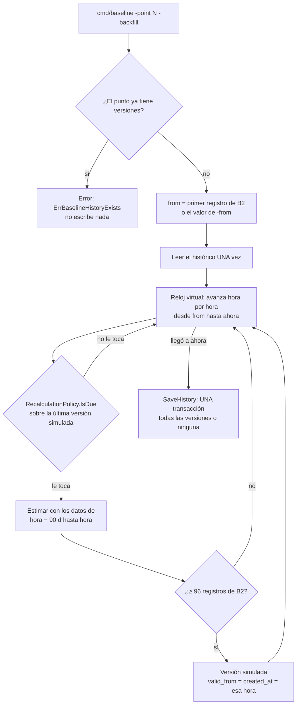
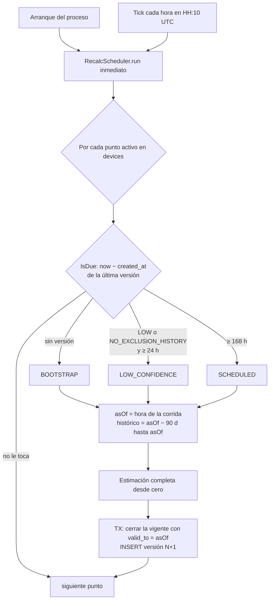

# Flujo del módulo Baseline: primera carga y recálculos

> Basado en el código actual y verificado contra los datos reales del punto 11556 (2026-10-10).
> Defaults: `BASELINE_HISTORY_DAYS=90`, `BASELINE_TICK_MINUTE=10`,
> `BASELINE_RECALC_INTERVAL=168h`, `BASELINE_LOW_RECALC_INTERVAL=24h`.
> Todas las horas del módulo son **UTC** (Bogotá = UTC − 5).

---

## 1. Resumen

1. Una versión de línea base **nunca se aplica hacia atrás**: vale desde su `valid_from` en adelante.
2. Por eso la primera carga de un punto se hace con **backfill** (`cmd/baseline -backfill`): crea de una vez todas las versiones que el módulo habría generado desde el primer dato.
3. De ahí en adelante manda el `RecalcScheduler`: revisa cada hora (minuto `:10` UTC) si al punto le toca recalcular, y si le toca crea una versión nueva.
4. Cada versión se calcula **desde cero** con los 90 días anteriores a su `valid_from`. No hay cálculo incremental.
5. Del cálculo se sacan dos cosas: lo que el propio módulo detecta como anómalo, y los **eventos conocidos** (fugas, intervenciones), que hoy son una lista fija en código.
6. Las versiones viejas no se borran ni se modifican: solo se les cierra `valid_to`.

---

## 2. Las tres formas de crear versiones

| Forma | Comando / disparo | Cuándo usarla | Trigger |
|---|---|---|---|
| **Backfill** (UC-B4) | `go run ./cmd/baseline -point N -backfill` | **Una vez**, al dar de alta un punto que ya tiene datos históricos | `BOOTSTRAP`, `LOW_CONFIDENCE`, `SCHEDULED` (los que asigna la política) |
| **Scheduler** (UC-B2) | Automático, con `baseline` en `AGATHA_MODULES` | Operación normal | Igual que arriba |
| **Manual** (UC-B1) | `go run ./cmd/baseline -point N [-asof …]` | Validación con el analista o forzar una versión ahora | `MANUAL` |

Las tres usan el mismo estimador, la misma ventana de 90 días y la misma lista de eventos conocidos. Solo cambia quién decide el `asOf`.

### 2.1 Qué datos NO entran al cálculo

| Origen | Quién lo decide | Dónde vive | Flag |
|---|---|---|---|
| **Exclusión automática** | El barrido: horas con `I(24 h) ≥ 0,18` excluyen su ventana `[t − 24 h, t)` | Se recalcula en cada versión | — |
| **Eventos conocidos** | Una lista de intervalos por punto | Hoy: `infrastructure/knownevents/static_provider.go`. Después: el módulo de alertas, por el port `KnownEventsProvider` | `KNOWN_EVENTS_EXCLUDED` |

Eventos conocidos del punto 11556 (hora Bogotá), tomados de la tabla `PERIODOS` del notebook del analista:

| Evento | Desde | Hasta |
|---|---|---|
| 22–28 jul (ambiguo) | 23-jul 06:00 | 28-jul 06:00 |
| E1 extendido | 24-jul 00:00 | 3-ago 00:00 |
| E1 | 28-jul 00:00 | 2-ago 00:00 |
| E2 | 20-ago 00:00 | 23-ago 00:00 |
| E3 pre-explosión | 23-ago 00:00 | 25-ago 06:00 |
| E4 intervención | 25-ago 06:00 | 27-ago 12:00 |
| E5 post-reparación | 27-ago 12:00 | 30-ago 00:00 |

Unidos son dos bloques: **23-jul 06:00 → 3-ago 00:00** y **20-ago 00:00 → 30-ago 00:00** (unos 20,7 días).

- Las referencias `R1`–`R7` y el tramo "Nuevo" de esa tabla **no** están en la lista: son comportamiento normal y tienen que entrar a la línea base.
- Los eventos se excluyen desde la primera pasada, aunque el barrido no los detecte, y cuentan para el tope del 40 %.
- Para agregar o quitar un evento hoy hay que editar `staticEvents` y desplegar. Las versiones ya creadas no cambian.

---

## 3. Primera carga: backfill

### 3.1 Qué hace



Reglas:

- **Solo datos anteriores**: cada versión usa `[valid_from − 90 d, valid_from)`. Nunca ve datos posteriores a su propio recálculo.
- **Eventos conocidos con retrospectiva**: una versión simulada excluye la parte ya transcurrida de un evento aunque en ese momento todavía no se supiera que lo era. La versión del 24-jul ya excluye lo ocurrido desde el 23-jul 06:00.
- **Cadencia real**: la primera versión aparece en la primera hora en punto con ≥ 96 registros de B2. Mientras la versión sea `LOW` o tenga `NO_EXCLUSION_HISTORY`, hay una nueva cada 24 h. Cuando sale `NORMAL`, una cada 168 h.
- **`created_at = valid_from`**: la versión queda registrada como si se hubiera creado en su momento. No guarda la hora real en que se escribió, y no se distingue de una versión creada por el scheduler.
- **Precondición**: el punto no puede tener versiones. Con `-dry-run` no se exige (solo muestra).
- **Atomicidad**: si algo falla, no queda ninguna versión.

### 3.2 Comandos

```bash
# 1. Previsualizar (no guarda versiones)
go run ./cmd/baseline -point 11556 -backfill -dry-run

# 2. Cargar el histórico
go run ./cmd/baseline -point 11556 -backfill

# Opcional: empezar desde una fecha en lugar del primer registro
go run ./cmd/baseline -point 11556 -backfill -from 2026-08-01T00:00:00Z
```

Si el punto ya tiene versiones, hay que borrarlas antes (primero los componentes, por la FK):

```sql
DELETE FROM baseline_component_stats
WHERE baseline_version_id IN (SELECT id FROM baseline_versions WHERE measuring_point_id = 11556);

DELETE FROM baseline_versions WHERE measuring_point_id = 11556;
```

> Borrar versiones es seguro mientras Processing no haya escrito `feature_evaluations` que las referencien por `baseline_version_id`.

### 3.3 Resultado real del punto 11556 (dry-run del 2026-10-10)

El primer registro de B2 es del **2026-07-08 05:15 UTC** (8 de julio, 00:15 en Bogotá). Con los eventos conocidos excluidos, el backfill genera **38 versiones**:

| Tramo | Versiones | Cadencia | Confianza | Qué pasa |
|---|---|---|---|---|
| 9-jul → 14-jul | v1 a v6 | diaria | `LOW` + `NO_EXCLUSION_HISTORY` | Aún no hay 20 ventanas de 24 h, así que no hay estadísticas de 24 h ni exclusión |
| 15-jul → 22-jul | v7 a v14 | diaria | `LOW` | Ya hay estadísticas, pero menos de 60 ventanas |
| 23-jul → 5-ago | v15 a v28 | diaria | `LOW` + `KNOWN_EVENTS_EXCLUDED` | Evento de julio: se excluye desde el primer día, y las muestras útiles se quedan fijas en 1.337 hasta que termina |
| 6-ago | v29 | — | **`NORMAL`** | Primera versión con 60 ventanas de 24 h |
| 13-ago → 8-oct | v30 a v38 | **semanal** (jueves 17:00 UTC) | `NORMAL` | `θ_D` baja de 71 a 67 y la mediana de 56 a 54 |

La última, **v38**, tiene `valid_from = 2026-10-08 17:00 UTC`, `θ_D = 67`, mediana 54, 26,5 % excluido, y queda vigente.

Efecto de la lista de eventos: sin ella, la versión del 24-jul todavía contaba el arranque de la fuga como normal y `θ_D` subía a 74. Con la lista, esa versión da 70.

### 3.4 Qué gana Processing

`GetEffectiveBaseline(at)` devuelve la versión con `valid_from ≤ at < valid_to`.

- Con backfill: cualquier hora desde el 9-jul 17:00 UTC tiene su versión.
- Sin backfill (una sola versión creada hoy): todas las horas anteriores a hoy devuelven `Status = NONE`, Processing escribe `NO_SIGNAL_BASELINE`, y esas filas son inmutables.

---

## 4. A futuro: recálculo automático

> Hoy `docker-compose.yml` levanta `AGATHA_MODULES: callback,dashboard`. **El scheduler de Baseline no está corriendo.**
> Mientras no se agregue `baseline`, la última versión queda vigente sin actualizarse.

### 4.1 La regla



No es un cron de "tal día a tal hora". El recálculo ocurre en el **primer tick después** de que la última versión cumple la edad. El día y la hora quedan anclados a cuándo se creó la versión anterior.

### 4.2 Calendario del punto 11556 después del backfill

La v38 tiene `created_at = jueves 2026-10-08 17:00:00 UTC`.

| Versión | Se cumple la edad | **Tick que la toma** (UTC) | Bogotá | Histórico usado |
|---|---|---|---|---|
| v39 | jue 15-oct 17:00:00 | jue 15-oct **17:10** | 12:10 | 17-jul → 15-oct |
| v40 | jue 22-oct 17:10:1x | jue 22-oct **18:10** ⚠️ | 13:10 | 24-jul → 22-oct |
| v41 | jue 29-oct 18:10:1x | jue 29-oct **19:10** ⚠️ | 14:10 | 31-jul → 29-oct |
| … | | +1 h por semana | | ventana deslizante de 90 días |

Si el scheduler se habilita **después** del 15-oct 17:00 UTC, la v39 se crea en el arranque del proceso y el calendario queda anclado a ese instante.

### 4.3 ⚠️ Deriva de +1 hora por recálculo (pendiente, no corregida)

- El tick usa `HH:10:00` como `asOf`, pero `created_at` se toma **después** de leer la BD y estimar (unos 14 s en la corrida real).
- A la semana, el tick de la misma hora ve una edad de `167h59m46s`, menor a 168 h, y lo toma el tick siguiente.
- Efecto: en `NORMAL` el periodo real es de 169 h (el recálculo se corre una hora por semana). En `LOW` es de 25 h (una hora por día).
- El backfill no tiene deriva, porque usa `created_at = valid_from`. Por eso sus versiones caen todas a las 17:00 en punto.
- Arreglos posibles:
  - Guardar `created_at = asOf` también en el recálculo normal. Contra: se pierde el instante real de escritura.
  - Medir la edad con `valid_from`. Contra: hay que cambiar la política y sus tests.

### 4.4 Casos particulares

| Situación | Qué pasa |
|---|---|
| La versión sale `LOW` | Se recalcula cada ~25 h hasta que una salga `NORMAL` |
| Se reinicia el proceso | No se reinicia el calendario: `IsDue` se evalúa contra el `created_at` guardado |
| El proceso estaba caído cuando tocaba | Recalcula en el arranque o en el primer tick. No se pierde la semana |
| Histórico insuficiente (< 96 registros de B2) | No se crea versión; se reintenta cada hora |
| Llegan datos tarde | Entran en el **próximo** recálculo si caen en su ventana. Una versión ya creada no se recalcula |
| Alguien corre `cmd/baseline` a mano | Crea una versión `MANUAL` vigente desde ese instante; el scheduler cuenta 168 h desde ahí |

---

## 5. Preguntas frecuentes

| Pregunta | Respuesta |
|---|---|
| ¿Toma los últimos 3 meses y ya? | Toma **90 días exactos** antes de `valid_from`, no meses calendario. La ventana se desliza con cada versión |
| ¿Reutiliza la versión anterior? | No. Lee los datos crudos y recalcula todo, incluida la exclusión de anómalos |
| ¿Qué pasa con las versiones viejas? | Quedan con `valid_to` cerrado. Processing las usa para las horas en que estuvieron vigentes |
| ¿Puedo volver a correr el backfill? | Solo si borro antes todas las versiones del punto |
| ¿El backfill da siempre lo mismo? | Sí, mientras no cambien los datos crudos: es determinista |
| ¿Cuándo deja de pesar un dato? | 90 días después de su timestamp |

---

## 6. Limitaciones conocidas

- **Sacar los eventos conocidos vuelve más sensible la exclusión automática.** La línea base queda más estrecha y el barrido marca más horas marginales (I entre 0,18 y 0,25), algunas dentro de periodos que el analista considera de referencia (R2, R3, R7). El resultado depende del día: la versión del 8-oct converge con 26,5 % excluido; un recálculo del 10-oct no convergió y quedó en 38,4 % (`BASELINE_REVIEW`), cerca del tope del 40 %.
- **La lista de eventos es estática**: un evento nuevo no se excluye hasta que alguien lo agrega al código.
- **`excluded_ratio` se calcula sobre los 90 días nominales**, no sobre el tiempo con datos. En las primeras versiones del histórico queda subestimado: la del 2-ago marca 11,57 %, que son 10,4 días excluidos sobre unos 25 días de datos reales.
- **Anomalía con mala cobertura**: una ventana de 24 h con menos del 70 % de cobertura no se puede marcar como anómala, pero sus muestras sí entran a `θ_D`. Una anomalía larga con pérdida de datos puede contaminar el umbral sin ningún flag.
- **Las rachas (P) se cortan al perder un solo slot**, así que P queda subestimado cuando hay pérdida repartida.
- **Cobertura del 11556**: ronda el 74 %. Con ~30 % de pérdida las ventanas válidas caen de golpe y la confianza pasa a `LOW`.
