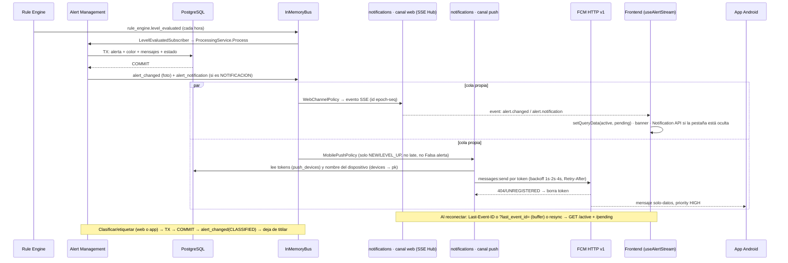

# Plan: módulo de notificaciones

Módulo de notificaciones de extremo a extremo:

- Alert Management publica eventos de dominio.
- El módulo de notificaciones los reparte por dos canales: web en tiempo real (SSE) y móvil (FCM HTTP v1).
- El frontend los aplica de inmediato al mapa, al banner y al panel.

> **Autorización del backend (2026-10-30).** El responsable del backend autorizó tocar `backend/` con estas condiciones:
> - Cambios **mínimos y aditivos** en `alert_management`, sin refactors innecesarios.
> - Correr las pruebas existentes **antes y después de cada commit** (`go test ./...` y `go vet ./...`).
> - Si se encuentra algo mal en su código, **se reporta** (sección 8) y no se corrige.
> - **Avisar antes** de empezar los commits que tocan `alert_management` (1, 2 y 3), para coordinar con él.

---

## 0. Restricciones por trabajar contra la base de producción

La base de datos es la del piloto, la misma que usa el backend del VPS.

- **Las pruebas automáticas usan fakes y stores en memoria.** Nunca se corre `go test -tags integration`: esas pruebas leen `DATABASE_URL` y, con el `.env` cargado en la terminal, irían contra producción.
- **Backend local**: solo con `AGATHA_MODULES=notifications` (más `dashboard`, que es de solo lectura, si hace falta). Ver la sección 6.3. Nunca con `baseline`, `processing`, `rule_engine`, `alert_management`, `dataos` ni `callback`.
- **El endpoint de eventos de prueba no escribe alertas.** Solo publica en el bus del proceso local, que está aislado del bus del VPS.
- **La migración de `push_devices` es solo aditiva**: `CREATE TABLE IF NOT EXISTS` más índices. No altera ni borra tablas existentes.
- **Pushes reales desde local**: `push_devices` tiene los tokens reales del piloto. En local, el envío corre en `FCM_VALIDATE_ONLY=true` (FCM valida y no entrega) o restringido con `NOTIFICATIONS_PUSH_DEVICE_ALLOWLIST` a los `deviceId` de prueba.
- Cualquier paso que necesite el `.env` o conectarse a la base **se detiene y se avisa antes de ejecutarlo**.

---

## 1. Hallazgos

### Alert management: existe y está maduro
- **Entidades** ([alert.go](../backend/internal/modules/alert_management/domain/entities/alert.go)):
  - `Alert`: estado, nivel actual y máximo, `Runtime` y `Management`.
  - `Segment`: los "colores" de la alerta, en `alert_level_segments`.
  - `Message`: la línea de tiempo, en `alert_messages`.
  - `Observation`, `ProcessingState` y `Policy` versionada.
- **Estados**:
  - `ACTIVA ⇄ FINALIZADA`. Vuelve a `ACTIVA` por reactivación.
  - Gestión: `SIN_CLASIFICAR → CLASIFICADA_SIN_ETIQUETA → CLASIFICADA_CON_ETIQUETA`. Solo avanza, y un trigger en la BD lo garantiza.
  - Niveles: `NORMAL < AMARILLO < NARANJA < ROJO`.
- **Transiciones**: la función pura `Decide` devuelve `OPENED`, `REACTIVATED`, `UPDATED` (sube, baja o sin datos) y `FINISHED`. La clasificación y la etiqueta van aparte, en `ManagementService`.
- **¿Una escalada es la misma alerta?** **Sí.** Subir o bajar de nivel abre un color nuevo en la misma alerta, con el mismo `id`.
  - La reactivación dentro de 24 h, si la alerta sigue sin clasificar, también conserva el `id`.
  - Se crea una alerta nueva, con otro `id`, si la anterior ya estaba clasificada (`NEW_AFTER_CLASSIFIED`) o si pasaron 24 h o más (`OPEN`).
  - No hay un "episodio" como entidad. El único vínculo es `alert_processing_state.last_alert_id`.
- **Ya publica eventos después del commit**: `alert_management.alert_notification` ([contract](../backend/internal/modules/alert_management/contract/alert_notification.go), `schema_version 1`).
  - Sale un evento por cada mensaje `NOTIFICACION` nuevo: apertura, subidas y reactivación que supera el máximo.
  - Lleva `message_id` (clave de idempotencia), `alert_code`, `late`, `title` y `body`.
  - **Hoy no tiene suscriptores.** El README del módulo ya dice que el canal web/push y los reintentos son del módulo de notificaciones.
- **No publica nada en estos casos**:
  - Bajadas de nivel (`DOWNGRADE`).
  - Fin de la alerta (`END_NORMAL`).
  - Sin datos (`NO_CALC_START/END`).
  - **Clasificación y etiqueta**: `ManagementService` ni siquiera tiene un publicador.
  - Por eso, hoy la web no se enteraría de que un marcador rojo debe dejar de titilar.
- **Falta un dato que pide el contrato FCM**: `AlertNotification` no trae la clasificación, y el contrato exige no enviar push de alertas con *Falsa alerta*. Un test lo confirma: una falsa alerta "sigue notificando".
- **Lee `devices` con un modelo propio** (`DeviceDirectory`: `measuring_point_id → name`). El módulo de notificaciones hará lo mismo para sacar el `pk`, sin tocar `alert_management`.

### Event bus y tiempo real
- **Ya existe un bus**: `shared/eventbus` tiene la interfaz `Bus` y la implementación `InMemoryBus`.
  - Cada suscripción tiene su propia cola y su propio worker, con orden FIFO.
  - Atrapa los pánicos (`recover`) y corta por `handlerTimeout` (30 s).
  - Si la cola se llena descarta el evento más viejo (`DropOldest`, cola de 256).
  - **Ya da el aislamiento entre canales que pide el requisito.**
- **Reglas de aislamiento** (con `depguard` en `.golangci.yml`):
  - Un módulo consumidor no importa el `contract/` del publicador.
  - La traducción entre tipos y las suscripciones viven en `internal/bootstrap`.
  - `alert_management` no puede importar el bus.
  - `golangci-lint` no está instalado en esta máquina: las reglas se respetan a mano y se verifican en CI, si existe.
- **No hay nada de tiempo real**: ni WebSocket, ni SSE, ni `http.Flusher`, en backend ni en frontend.
- `backend/internal/modules/notifications/` existe, pero solo tiene un `README.MD` vacío.

### Router, wiring y configuración
- **El entrypoint es [cmd/platform/main.go](../backend/cmd/platform/main.go)**, que es el que compila el Dockerfile. (`cmd/api` se eliminó en `dev`).
  - Usa `ServeMux` con los patrones de Go 1.22 (`"GET /api/alerts/{id}"`).
  - Cada módulo registra sus rutas con `RegisterRoutes(mux)`, y todo se envuelve en `WithCORS`.
  - Los módulos se arman en [application.go](../backend/internal/bootstrap/application.go) según `AGATHA_MODULES` ([modules.go](../backend/internal/bootstrap/modules.go)), que valida las dependencias entre ellos.
- **Cadena de dependencias**: `alert_management → rule_engine → processing → baseline`. Cada uno arranca un scheduler que escribe en la base: catch-up de alertas (minuto 55), catch-up del rule engine, evaluación horaria y recálculo de líneas base. Además, `alert_management` migra su esquema y siembra la política global al arrancar. Por eso **no se puede levantar `alert_management` en local** sin procesar la base de producción en paralelo con el VPS.
- **Configuración**:
  - `godotenv` carga el `.env` en `NewPlatform`.
  - Cada módulo lee su propia variable de entorno, con un valor por defecto si falta. El entorno se lee de `AGATHA_ENV`.
  - **No existe `backend/.env.example`**. El `.dockerignore` excluye `.env*`.
- **No hay autenticación en ningún endpoint.** El origen viene del cuerpo (RN-10).

### Cambios que trajo `dev` (merge del 2026-10-30)
- `docker-compose.yml`: **`alert_management` ya está en `AGATHA_MODULES`** (verificado). El puerto ahora es `127.0.0.1:8080:8080`, así que solo el nginx del VPS llega al backend.
- `alert_management`: **sin cambios**. El análisis sigue vigente.
- `bootstrap`: refactor de la ingesta (`loadIngestionLocation`), `known_events.go` renombrado a `baseline_alert_events.go`. No afecta al plan.
- Ingestion ya no publica `ingestion.measurements_ingested`, y Processing borró su suscriptor. El scheduler horario de Processing es el único disparador automático. No afecta al plan: la cadena `processing.indicator_evaluated → rule_engine.level_evaluated → alert_management` sigue igual.
- Línea base de pruebas tras el merge: `go test ./...` y `go vet ./...` en verde.

### Frontend
- **El mapa, el panel y el toast todavía usan el modelo temporal `services/alerts`**, con `emptyAlerts.adapter`, que no devuelve datos.
  - `usePilotNodes` → `usePendingAlerts` (polling cada 30 s).
  - `RecentAlertsPanel` → `useRecentAlerts` y `usePendingAlerts`.
  - `NewAlertToast` → `useNewAlerts`: un estado a nivel de módulo que compara los ids de la lista "recientes".
  - `useDevices` hace polling cada 60 s.
- **Query keys**: `alertKeys` (`all`, `recent`, `pending`, `histories`, `management(id)`). No existe una key para `active`.
- **Ya consume la API real**: el historial y el modal de gestión, con `services/alertManagement` y la actualización fina de caché en `useAlertManagementMutations`.
- **El aviso gris se calcula en el cliente** a partir de `device.lastConnection`: más de 120 min sin datos es "sin comunicación".
- **El mapa ya está optimizado**: los íconos se cachean por `tone|warning|blinking`, así que cambiar un nodo no redibuja los demás.
- **El proxy de Vite** manda todo `/api` al VPS. Para la prueba manual se agrega `/api/notifications` → `localhost:8080` (antes que `/api`).

### Riesgos e inconsistencias que afectan este trabajo
1. **El `ReadTimeout: 15s` de `cmd/platform`** cancela el contexto de una conexión larga a los 15 s, por la lectura de fondo de `net/http`. El handler del stream debe limpiar los deadlines con `http.ResponseController`.
2. **CORS solo permite `GET`**. Lo corrige el usuario en un commit aparte (ver "Commit C" en la sección 5). El móvil no se ve afectado, porque CORS no aplica fuera del navegador.
3. **HTTPS**: el certificado es de Let's Encrypt para la IP (`129.213.118.230`), válido para el navegador, y el nginx del VPS ya tiene `proxy_buffering off` y `proxy_read_timeout 3600s` en `location /`. No hay que tocarlo. Conviene confirmar que la renovación automática esté activa: los certificados de IP de Let's Encrypt son de vida corta.
4. **HTTP/2 no está activo** (`listen 443 ssl` sin `http2`). Con HTTP/1.1 el navegador permite 6 conexiones por origen, y cada pestaña abierta ocupa una con el stream. Se le sugiere al responsable del backend como mejora. Mitigación en el cliente: el stream se cierra cuando la pestaña lleva un rato oculta y se reabre al volver.
5. **El bus pierde eventos si el proceso se cae** entre el commit y la publicación. En la web lo cubre la resincronización por REST. En el push, ese aviso se perdería. La fuente de verdad sigue siendo `alert_messages` (`kind = NOTIFICACION`), que funciona como un outbox natural para conciliar más adelante.
6. **Datos del contrato FCM**:
   - `alertId`: se envía el código (`ALR-000142`). Se corrige el ejemplo del contrato, que decía `ALR-0142`.
   - `pk`: se extrae de `devices.name` con la misma regla que `extractPk` del frontend (`PK34-470` → `34+470`). Si no se puede, se omite (es opcional).
   - Los enums están en español (`AMARILLO`, `FUGA`) y la app espera inglés (`YELLOW`, `LEAK`). Se mapean.
7. **El backend no modela un "aviso gris" por dispositivo.** Se queda en el cliente para esta entrega.
8. **El banner detecta "nuevas" por id de alerta.** Un `LEVEL_UP` conserva el id, así que hoy no aparecería. Se pasa a `messageId`.
9. **Un test de alertas exige que no existan `/api/alerts/push-devices` ni `/api/alerts/notifications`.** El registro de tokens tiene que ir fuera de `/api/alerts`, y la ruta del contrato ya lo está.
10. **Endpoints abiertos (riesgo conocido y aceptado para el piloto).** Sin autenticación, cualquiera podría registrar un token y recibir alertas, o abrir el stream. Mitigaciones: cuerpo máximo de 4 KB en el registro, `token` ≤ 4096 caracteres, `deviceId` ≤ 128, `platform = ANDROID`, y un tope de clientes SSE simultáneos (`NOTIFICATIONS_SSE_MAX_CLIENTS`, 200 por defecto). Se documenta en el README del módulo.
11. **Base de producción**: ver la sección 0. Afecta la prueba manual (sección 6.3) y obliga a que `notifications` no exija `alert_management` en `ParseModules`.

---

## 2. Decisiones

### Decisión 1. Transporte web: **Server-Sent Events**

| | SSE | WebSocket |
|---|---|---|
| Dirección | Servidor → cliente, que es el caso | Bidireccional, y no se necesita |
| Dependencias en Go | Ninguna (`http.Flusher` de la stdlib). El proyecto evita dependencias: el Excel se hizo solo con stdlib | Requiere `coder/websocket` o `gorilla` |
| Reconexión | Nativa en `EventSource`, con `retry:` y reenvío de `Last-Event-ID` | A mano |
| Proxy y HTTPS | HTTP normal; el nginx del VPS ya tiene `proxy_buffering off` | Exige el `Upgrade` en el proxy |
| CORS y auth | GET simple. Contra: `EventSource` no envía cabeceras propias, así que un token futuro iría en cookie o query | Mismo problema de cabeceras |
| Límite | 6 conexiones por origen en HTTP/1.1 (riesgo 4) | No tiene ese límite |

**SSE.** El flujo es unidireccional y el estándar ya trae la reconexión y el reenvío por id. No agrega dependencias y es lo más simple de explicar y defender.

Para no perder eventos se usan tres mecanismos juntos:
- **Ids de evento**: el hub numera cada evento como `<epoch>-<seq>` y guarda los últimos 256 en un buffer circular. Al reconectar, el servidor toma el último id de la cabecera `Last-Event-ID` (reconexión nativa del navegador) o del parámetro `?last_event_id=` (reconexión manual del cliente, que crea un `EventSource` nuevo y no tiene cabecera). Le reenvía lo que faltó; si el id no está en el buffer o cambió el epoch (el servidor se reinició), le manda `event: resync`.
- **Resincronización por REST en cada reconexión**: el cliente vuelve a pedir `/active` y `/pending`. Es la fuente de verdad.
- **Heartbeat**: un comentario `: ping` cada 25 s. El cliente reconecta si pasan 60 s sin recibir nada.

### Decisión 2. Event bus: **reutilizar `shared/eventbus`; no crear otro**
- El puerto ya existe: `Bus` del lado técnico, y `ports.NotificationPublisher` del lado de dominio.
- Los publicadores dependen solo de sus puertos. Los suscriptores son structs con `Handle(ctx, Notice)`. Solo `bootstrap` conoce el bus.
- **Cambio futuro a outbox o broker**: se cambia el adaptador en `bootstrap` (`busAlert…Publisher`) y cómo se registran los suscriptores, sin tocar publicadores ni consumidores.
- Matiz: un outbox *transaccional* requiere escribir dentro de la transacción. Lo más barato sería un "conciliador" que lea `alert_messages.id > último_enviado`, porque esa tabla ya cumple ese papel.
- **Aislamiento de canales**: cada canal es una suscripción distinta al bus, con su propia cola y su propio worker (`notifications.alert_notification.web` y `notifications.alert_notification.push`). Si FCM tarda, solo se atrasa su cola; ni el canal web ni la gestión de alertas lo notan.

### Decisión 3. Catálogo de eventos
Los dos tópicos los publica `alert_management`, siempre después del commit:

| Tópico | Cuándo | Lo consume |
|---|---|---|
| `alert_management.alert_notification` (existe; v1 + campos compatibles `classification` y `started_at`) | Cada mensaje `NOTIFICACION` nuevo | Push (FCM) y banner web |
| **`alert_management.alert_changed`** (nuevo, v1) | Cualquier cambio visible de una alerta. `change` ∈ `OPENED`, `LEVEL_RAISED`, `LEVEL_LOWERED`, `REACTIVATED`, `FINISHED`, `NO_DATA_STARTED`, `NO_DATA_ENDED`, `CLASSIFIED`, `LABELED` | Canal web (mapa y panel) |

- **Payload de `alert_changed`**: es una foto del estado.
  - Campos: `alert_id`, `alert_code`, `measuring_point_id`, `event_type`, `change`, `state`, `current_level`, `max_level`, `blinking`, `management_status`, `classification` y `started_at`.
  - Además, `evaluated_at` (el reloj del procesamiento), `occurred_at` y `schema_version`.
- **Por qué un tópico con discriminador y no 9 tópicos**:
  - Al cliente le basta con un reducer del tipo "aplicar la foto si es más nueva".
  - `change` conserva la semántica de dominio para los logs y la UI.
  - Se aparta de la regla "eventos con referencias, no datos", y se justifica así: evita N consultas REST por evento, y la foto es pequeña.
- **Cómo el cliente descarta duplicados y eventos viejos**, sin columna nueva en la BD:
  - Los campos de **nivel y estado** solo se aplican si `evaluated_at` es mayor que el que está en caché. El orden está garantizado: el lock por punto procesa las horas en orden y descarta las repetidas.
  - Los campos de **gestión** solo se aplican si el rango de `management_status` es mayor, porque la gestión solo avanza.
  - `blinking` se recalcula en el cliente con `ACTIVA ∧ ROJO ∧ sin clasificar`.
  - Las notificaciones se deduplican por `message_id`.
- **Aviso gris**: se mantiene el cálculo en el cliente (`lastConnection` + `useNow`), y `alert_changed` con `NO_DATA_*` cubre el caso "Alerta + aviso". El evento por dispositivo queda como mejora futura (sección 9).

**Mapeo al push FCM** (estrategia `MobilePushPolicy`):
- **`kind`**:
  - `OPEN` y `NEW_AFTER_CLASSIFIED` → `NEW`.
  - `UP_*` y `REACTIVATED` → `LEVEL_UP`.
- **Se descarta y no se envía** si:
  - `late = true` (las horas atrasadas sí van a la web).
  - `classification = FALSA_ALERTA`.
  - El nivel no es Amarillo, Naranja ni Rojo.
  - El código es desconocido.
- **Formato del mensaje**:
  - `alertId` = código de la alerta (`ALR-000142`). `pk` = abscisa extraída de `devices.name`, u omitido.
  - Niveles: `AMARILLO/NARANJA/ROJO` → `YELLOW/ORANGE/RED`. Eventos: `FUGA` → `LEAK`.
  - Todos los valores van como string, con `android.priority = HIGH` y sin bloque `notification`.

### Decisión 4. Credencial y configuración de FCM
- **Archivo montado**: `FCM_SERVICE_ACCOUNT_FILE` (montado en solo lectura en Docker). Como respaldo, `FCM_SERVICE_ACCOUNT_JSON_BASE64`, que son ~10 líneas más; si hay archivo, tiene prioridad.
- **Proyecto**: `FCM_PROJECT_ID=agatha-5fe71`, por variable (no se lee del JSON).
- **Sin credencial** → `NoopSender`, que registra en el log que el push está deshabilitado. El canal web sigue funcionando.
- **`FCM_VALIDATE_ONLY=true`** usa `validate_only` de FCM v1: valida el mensaje y el token sin entregarlo. Es para local.
- **`NOTIFICATIONS_PUSH_DEVICE_ALLOWLIST`** (opcional, `deviceId` separados por coma): si está definida, solo se envía a esos dispositivos. Es para probar en un celular desde local sin llegar a los del piloto.
- El backend nunca lee ni muestra el contenido del JSON en logs ni en errores.

### Decisión 5. Módulo `notifications` en `AGATHA_MODULES`
- `notifications` **no exige** `alert_management` en `ParseModules`. Sin él no le llegan eventos reales, y lo advierte en el log al arrancar. Así se puede levantar solo en local (sección 0).
- En el VPS: `callback,dashboard,baseline,processing,rule_engine,alert_management,notifications`.
- **Endpoint de eventos de prueba** (`POST /api/notifications/test-event`): solo con `NOTIFICATIONS_TEST_ENDPOINT=true` y `AGATHA_ENV` distinto de `production`. El handler vive en `notifications` y recibe un puerto `TestEventEmitter`, que implementa `bootstrap` publicando los contratos de `alert_management` en el bus. Así recorre el mismo pipeline sin que `notifications` importe esos contratos y sin escribir en la base.

### Decisión 6. Frontend
- El permiso de notificaciones del navegador se pide **con un botón en el indicador de conexión**, nunca al cargar la app.

**Qué se avisa en pantalla.** Solo los mensajes `NOTIFICACION` (`alert.notification`). Todo lo demás (`alert.changed`) actualiza el mapa y el panel en silencio.

| Avisa (banner, notificación del navegador, sonido y push) | No avisa: solo actualiza mapa y panel |
|---|---|
| Alerta nueva: `OPEN`, `NEW_AFTER_CLASSIFIED` | Bajadas de nivel, fin de la alerta |
| Subida de nivel: `UP_NARANJA_*`, `UP_ROJO` | Horas sin datos y su regreso (`NO_CALC_*`) |
| Reactivación que supera el máximo anterior | Actualizaciones horarias (tendencia, cuenta regresiva, resumen…) |
| | Subidas durante una intervención (la política las silencia), clasificación y etiqueta |

- **Volumen**: la evaluación es horaria, así que hay como máximo un aviso por punto y hora. Una alerta típica genera de 1 a 3 avisos (abre, sube a Naranja, sube a Rojo). Volver a subir después de una bajada sí avisa otra vez, pero la bajada exige varias horas estables por debajo, así que no hay ping-pong.
- **Un aviso por alerta en pantalla**: el banner agrupa por `alertCode`, y un aviso nuevo de la misma alerta reemplaza al anterior en vez de apilarse. La notificación del navegador usa `tag = alertCode` para que el sistema operativo haga lo mismo. Se muestran como máximo 3 banners a la vez.
- **Sonido**: un tono corto al llegar un aviso, más insistente en Rojo.
  - Los navegadores bloquean el audio hasta que el usuario interactúa con la página. El botón del indicador que activa las notificaciones también habilita el sonido, y tiene un control para silenciarlo (se recuerda en `localStorage`).
  - Suena una sola vez por `messageId` y en una sola pestaña (coordinadas con `BroadcastChannel`).
  - El tono se genera con la Web Audio API, sin archivos de audio.
  - En el celular, el sonido lo decide la app con su canal de notificación (el mensaje es solo de datos). Se anota en el contrato FCM.
- **Avisos atrasados (`late`)**: en la web se avisan igual que los demás (banner, sonido y notificación del navegador), con la etiqueta "Atrasado" para que no se ignoren. No van al push (decisión de la pregunta 7).

---

## 3. Flujo del evento

---

## 4. Archivos

**Backend.** `N` = nuevo, `M` = modificado. Los archivos de `notifications/` están bajo `backend/internal/modules/notifications/`.

| Ruta | | Qué cambia y por qué |
|---|---|---|
| `alert_management/contract/alert_notification.go` | M | Agrega `Classification` y `StartedAt` (campos compatibles, v1). La regla "no enviar Falsa alerta" los necesita |
| `alert_management/contract/alert_changed.go`, `topics.go` | N/M | `AlertChanged` + `TopicAlertChanged` |
| `alert_management/application/ports/ports.go` | M | Puerto `AlertChangePublisher` |
| `alert_management/application/services/processing_service.go` (+test) | M | Junta los cambios dentro de la TX y los publica después del commit (backfill no publica) |
| `alert_management/application/services/management_service.go` (+test) | M | Publica `CLASSIFIED`/`LABELED` después del commit, solo cuando el resultado es `SAVED` |
| `alert_management/ALERT_MANAGEMENT_README.MD` | M | Documenta el nuevo tópico |
| `bootstrap/alert_management.go` | M | Adaptadores hacia el bus para los dos tópicos |
| `bootstrap/notifications.go` (+`_test.go`) | N | Wiring, traducción contrato→Notice, suscripciones con nombre, `TestEventEmitter` y prueba de punta a punta con el bus real |
| `bootstrap/modules.go`, `application.go`, `modules_test.go` | M | `ModuleNotifications`, sin dependencia obligatoria (decisión 5) |
| `cmd/platform/main.go` | M | Solo el comentario con la lista de módulos |
| `notifications/domain/entities/*.go` | N | `AlertNotice`, `AlertChange`, `PushDevice`, enums `PushKind`, `PushLevel` |
| `notifications/domain/policies/*.go` (+tests) | N | **Strategy**: `ChannelPolicy` + `MobilePushPolicy`, `WebPolicy` |
| `notifications/domain/pk.go` (+test) | N | Extrae la abscisa de `devices.name` (`PK34-470` → `34+470`), igual que `extractPk` |
| `notifications/application/ports/*.go` | N | `PushTokenRepository`, `PushSender`, `RealtimeBroadcaster`, `DeviceDirectory`, `TestEventEmitter`, `Clock` |
| `notifications/application/services/*.go` (+tests) | N | `PushTokenService` (upsert), `MobilePushService` (filtro → allowlist → envío a cada token → reintentos → limpieza), `WebRealtimeService` |
| `notifications/infrastructure/events/*.go` | N | Subscribers + Notices propios (**Observer**) |
| `notifications/infrastructure/fcm/*.go` (+tests) | N | **Adapter** `HTTPV1Sender` (OAuth2 con la cuenta de servicio, archivo o base64, `validate_only`), constructor del mensaje según el contrato, backoff, `NoopSender` si no hay credencial |
| `notifications/infrastructure/fcm/fcmtest/fake_sender.go` | N | Sender falso que graba lo enviado o devuelve errores programados |
| `notifications/infrastructure/realtime/*.go` (+tests) | N | **Adapter** `SSEHub` (clientes, tope de clientes, buffer circular, heartbeat, descarta clientes lentos) + `StreamHandler` |
| `notifications/infrastructure/http/push_token_handler.go` (+test) | N | `PUT /api/devices/push-token` → 204, con límites de tamaño |
| `notifications/infrastructure/http/test_event_handler.go` (+test) | N | `POST /api/notifications/test-event` (decisión 5) |
| `notifications/infrastructure/persistence/{schema,models,mappers,repositories}` | N | Tabla `push_devices` + `Migrate` idempotente y solo aditivo; lector de `devices` (solo lectura) |
| `notifications/README.MD` | M | Documentación del módulo, incluidos los riesgos conocidos (hoy está vacío) |
| `.golangci.yml` | M | Regla `notifications-isolation` (no importa `alert_management` ni el bus) |
| `go.mod` / `go.sum` | M | `golang.org/x/oauth2` (tokens de la cuenta de servicio). Se evita el Firebase Admin SDK, que es pesado; con HTTP directo el sender falso es trivial |
| `.env.example` | N | `FCM_*`, `NOTIFICATIONS_*` con valores de ejemplo, sin secretos |
| `docker-compose.yml` | M | Agrega `notifications` a `AGATHA_MODULES` y monta la credencial en solo lectura |
| `shared/eventbus/README.md` | M | Catálogo de eventos actualizado |

**Frontend** (todo bajo `frontend/src/`, salvo `vite.config.ts`):

| Ruta | | Qué cambia y por qué |
|---|---|---|
| `services/alertManagement/{types,service,http}.ts` (+test) | M | `getActive()` y `getPending()` con los tipos `ActiveResponse` y `PendingResponse` |
| `services/alerts/*` | **Eliminado** | Modelo temporal con adaptador vacío |
| `services/http/httpClient.ts` | M | Exportar `apiUrl()` para que `EventSource` use la misma URL base |
| `services/realtime/alertStream.{types,client}.ts` (+test) | N | Contrato de los eventos web y wrapper de `EventSource`: backoff con jitter, watchdog de 60 s, reconexión manual con `?last_event_id=` cuando `readyState = CLOSED` |
| `features/alerts/hooks/alertKeys.ts` | M | Agrega `active()` |
| `features/alerts/hooks/useAlerts.ts` | M | `useActiveAlerts` y `usePendingAlerts`. **El polling solo se activa si el stream está caído** |
| `features/alerts/hooks/useAlertStream.ts` | N | Conexión única (singleton) + `useSyncExternalStore` para el estado; aplica los eventos a la caché |
| `features/alerts/lib/streamCache.ts` (+test) | N | Reducers puros: `applyAlertChanged(active)`, `applyAlertChanged(pending)`, reglas de "más nuevo" |
| `features/alerts/lib/newAlerts.ts` (+test) | M | El banner se alimenta del stream, con clave `messageId` (cubre `LEVEL_UP`) |
| `features/alerts/lib/browserNotification.ts` | N | Notification API: solo con permiso, con la pestaña oculta y `tag = alertCode` |
| `features/alerts/lib/alertSound.ts` (+test) | N | Tono con Web Audio API (más insistente en Rojo), silencio recordado en `localStorage`, una vez por `messageId` y una sola pestaña (`BroadcastChannel`) |
| `features/alerts/components/{NewAlertToast,RecentAlertsPanel,AlertListItem}.tsx` | M | Pasan al modelo `AlertItem`/`AlertLevel` |
| `features/alerts/components/RealtimeStatus.tsx` | N | Indicador de conexión (En vivo / Reconectando / Sin conexión) + botón para activar las notificaciones del navegador |
| `features/alerts/config/alertDisplay.ts` (+test) | M | `SEVERITY_STYLES` indexado por `AlertLevel` |
| `features/map/hooks/usePilotNodes.ts`, `lib/nodeState.ts` (+test) | M | Usan `/active` (`level`, `blinking`); el gris se queda en el cliente |
| `app/RootLayout.tsx`, `components/layout/Header.tsx` | M | Montar `useAlertStream` una sola vez y mostrar el indicador |
| `frontend/vite.config.ts` | M | Proxy de desarrollo `/api/notifications` → `localhost:8080` (antes que `/api`) |
| `docs/CONTRATO_PUSH_FCM.md` | M | `alertId` = `ALR-000142`, regla del `pk` y valores finales para el equipo móvil |

---

## 5. Plan de commits

Se trabaja un commit a la vez: se hacen los cambios, se explican, se corren `go test ./...` y `go vet ./...` (o `npm test` y `npm run lint` en el frontend), se propone el mensaje y el usuario hace el commit antes de pasar al siguiente. Los mensajes van en inglés (Conventional Commits). Al terminar cada fase se marcan aquí los commits hechos.

**Fase 1: base del backend**

> ⚠️ Los commits 1, 2 y 3 tocan `alert_management`: avisar antes de empezarlos para coordinar con su responsable.

- [ ] 1. `feat(alert-management): add classification and start time to alert notification event`
- [ ] 2. `feat(alert-management): publish alert_changed after hourly processing commits`
- [ ] 3. `feat(alert-management): publish alert_changed after classification and labeling`
- [ ] 4. `feat(notifications): add domain model and channel policies`
- [ ] 5. `feat(bootstrap): wire notifications module and event subscriptions`

**Fase 2: canal web**
- [ ] 6. `feat(notifications): add SSE hub with heartbeat and replay buffer`
- [ ] 7. `feat(notifications): expose realtime alert stream endpoint`

**Fase 3: canal FCM**
- [ ] 8. `feat(notifications): persist push device tokens`
- [ ] 9. `feat(notifications): add push token registration endpoint`
- [ ] 10. `feat(notifications): add FCM HTTP v1 sender with service account auth`
- [ ] 11. `feat(notifications): deliver mobile push with retries and token cleanup`
- [ ] 12. `feat(notifications): add dev-only endpoint to emit test events`
- [ ] 13. `chore(backend): add env example with notification settings`
- [ ] 14. `chore(docker): enable notifications module and mount FCM credential`

**Commit C (lo hace el usuario, aparte): CORS.** Va antes de la fase 4, porque el frontend desplegado en Vercel lo necesita.
- Métodos: `GET, POST, PUT, OPTIONS`. Cabeceras: `Content-Type` y `Last-Event-ID`.
- `Last-Event-ID`: el navegador la agrega solo en la reconexión nativa de `EventSource`. No es una cabecera "segura" de CORS, así que según el navegador puede disparar un preflight; si el preflight falla, la reconexión falla del todo. Se permite por seguridad, y el servidor además acepta `?last_event_id=`, que no depende de CORS.
- Verificar en la pestaña Network del navegador, con el front de Vercel, que tras cortar el stream la reconexión no falle por CORS.

**Fase 4: frontend**
- [ ] 15. `feat(alerts): add active and pending endpoints to alert management service`
- [ ] 16. `refactor(alerts): migrate map and alert panel to alert management API`
- [ ] 17. `refactor(alerts): remove temporary alerts service`
- [ ] 18. `feat(realtime): add alert stream client with reconnection and watchdog`
- [ ] 19. `feat(alerts): apply stream events to query cache and pause polling while live`
- [ ] 20. `feat(alerts): drive new alert banner from stream notifications`
- [ ] 21. `feat(alerts): show browser notifications when tab is hidden`
- [ ] 22. `feat(alerts): play a sound for new and escalated alerts`
- [ ] 23. `feat(layout): add realtime connection indicator`

**Fase 5: pruebas y documentación**
- [ ] 24. `test(bootstrap): cover alert to web and push delivery end to end`
- [ ] 25. `docs(notifications): document module, event catalog and FCM contract`

---

## 6. Estrategia de pruebas

### 6.1 Backend (unitarias, sin base de datos)
- `MobilePushPolicy` (tabla de casos):
  - `OPEN` → `NEW`, `UP_ROJO` → `LEVEL_UP`.
  - `late`, `FALSA_ALERTA`, `NORMAL` o un código desconocido → no se envía.
- `WebPolicy`: deja pasar todo, incluidas las horas `late`.
- Extracción del `pk`: `"Sensor PK34-470"` → `34+470`; sin PK → se omite.
- Constructor del mensaje FCM: todos los valores string, `priority HIGH`, sin `notification`, `alertId` con el código, mapeo de enums, campos opcionales omitidos y `validate_only` cuando está activo.
- Backoff:
  - Con un reloj falso: reintenta en 429/5xx/red, respeta `Retry-After` y para en el máximo de intentos.
  - No reintenta en 400.
- Limpieza: un `httptest.Server` que simula FCM con 404/`UNREGISTERED` → el token se borra.
- Allowlist: con la lista definida, solo se envía a esos `deviceId`.
- Hub SSE:
  - Reparte a varios clientes y descarta al cliente lento sin bloquear a los demás.
  - Rechaza clientes por encima del tope.
  - Heartbeat.
  - `Last-Event-ID` o `?last_event_id=` dentro del buffer reenvía lo pendiente; fuera del buffer o con otro epoch manda `resync`.
- `StreamHandler`: cabeceras, flush, cierre al cancelar el contexto y sin corte a los 15 s.
- Publicador (alert management): "commit → publica" y "rollback → no publica", siguiendo el checklist del README del bus.
- `PushTokenService` y handler: el upsert es idempotente, un token repetido en otro `deviceId` se reasigna, y los cuerpos grandes o inválidos se rechazan.
- Endpoint de prueba: deshabilitado sin el flag o con `AGATHA_ENV=production`; con el flag, llama al emisor y no toca ningún repositorio.

**Sender falso**: `fcmtest.FakeSender` graba los mensajes y permite programar errores por token. Se usa en `MobilePushService` y en la prueba de punta a punta.

### 6.2 De punta a punta (`bootstrap`, bus real y stores en memoria)
Extiende `TestAlertManagement_EndToEndFromProcessing`: `processing.indicator_evaluated` → Rule Engine → Alert Management → notifications. Verifica que el `FakeSender` reciba solo `NEW`/`LEVEL_UP` y que un grabador del hub reciba `alert.changed`, incluido `CLASSIFIED`.

**Frontend (vitest, solo funciones puras)**: `streamCache` (aplicar, ignorar lo viejo, quitar de pendientes al clasificar), `newAlerts` con `LEVEL_UP`, backoff del cliente y parseo de eventos.

### 6.3 Prueba manual (requiere el `.env`; se avisa antes de cada paso)

**Módulos en local: `AGATHA_MODULES=notifications`** (y `dashboard` solo si el mapa lo necesita).

| Módulo | Qué escribe en la base de producción |
|---|---|
| `notifications` | Al arrancar: crea `push_devices` si no existe (aditivo). Después, solo si se llama `PUT /api/devices/push-token` (upsert) o si FCM responde `UNREGISTERED` para un token al que se envió (borra ese token). Lee `devices` y `push_devices` |
| `dashboard` | Nada: solo `GET` |
| `baseline`, `processing`, `rule_engine`, `alert_management`, `dataos`, `callback` | **No se activan.** Corren schedulers (líneas base, evaluación horaria, catch-up de niveles y de alertas, ingesta) o migraciones que escriben en la base que ya procesa el VPS |

Variables en local: `NOTIFICATIONS_TEST_ENDPOINT=true`, `AGATHA_ENV` distinto de `production`, y para FCM `FCM_VALIDATE_ONLY=true` o `NOTIFICATIONS_PUSH_DEVICE_ALLOWLIST=<deviceId de prueba>`.

1. Levantar el backend con esos módulos y variables.
2. Ver el stream: `curl -N http://localhost:8080/api/notifications/stream`.
3. Disparar un evento: `curl -X POST .../api/notifications/test-event -d '{"level":"ROJO","kind":"NEW","measuring_point_id":…}'`. Recorre el mismo pipeline del bus y no escribe alertas.
4. En la web (proxy `/api/notifications` → local, el resto → VPS): el marcador cambia, aparece el banner y, con la pestaña oculta, la notificación del navegador.
5. En el celular: registrar el token desde la app, ponerlo en la allowlist y repetir el paso 3.
6. Probar la reconexión: reiniciar el backend local y comprobar que el indicador pasa a "Reconectando" → "En vivo" y que se resincroniza.

---

## 7. Preguntas resueltas (2026-10-30)

| # | Tema | Decisión |
|---|---|---|
| 1 | Backend | Autorizado, con condiciones (inicio del documento) |
| 2 | `alertId` | Código `ALR-000142`; se corrige el ejemplo del contrato |
| 3 | `pk` | Se extrae de `devices.name`; si no se puede, se omite. Mejora futura: columna propia |
| 4 | Aviso gris | En el cliente; evento por dispositivo como mejora futura |
| 5 | Credencial FCM | Archivo montado (`FCM_SERVICE_ACCOUNT_FILE`), base64 de respaldo; proyecto `agatha-5fe71` |
| 6 | Ruta de registro | `PUT /api/devices/push-token`, 204 |
| 7 | `late` | No va al push; sí a la web |
| 8 | Despliegue | `alert_management` ya está en `AGATHA_MODULES`; se agrega `notifications`. nginx sin cambios; certificado de Let's Encrypt; HTTP/2 como mejora sugerida |
| 9 | Seguridad | Sin autenticación en el piloto, con límites de tamaño; riesgo conocido documentado |
| 10 | Permiso del navegador | Botón en el indicador |
| 11 | CORS | Commit aparte del usuario (Commit C) |

---

## 8. Reportes para el responsable del backend

Observaciones sobre su código. **No se corrigen aquí.**

1. **Una falsa alerta sigue notificando**: `AlertNotification` no lleva la clasificación, y un test lo confirma. El commit 1 agrega el campo (aditivo) y el filtro queda en `notifications`. Hay que confirmar que ese es el comportamiento esperado en `alert_management`.
2. **No se puede levantar la API de alertas sin la cadena de schedulers**: `alert_management` exige `rule_engine → processing → baseline`, y cada uno arranca su scheduler. No hay forma de levantar `/api/alerts` en solo lectura (por ejemplo, para desarrollo contra la base del piloto). Sugerencia: una variable que deshabilite los runners.
3. **Catálogo del bus desactualizado**: en `shared/eventbus/README.md`, `rule_engine.level_evaluated` dice "Ninguno hoy (Alert Management)", pero `alert_management` ya está suscrito. El commit 25 actualiza el catálogo de los tópicos nuevos; esa fila se le deja a él.
4. **HTTP/2 en nginx** (`listen 443 ssl http2`), para el límite de conexiones del navegador (riesgo 4).

---

## 9. Mejoras futuras

- **Abscisa como columna del dispositivo**: hoy el `pk` se deduce de `devices.name`.
- **Evento de aviso gris por dispositivo**, a partir de las horas `NO_CALCULABLE` del Rule Engine.
- **Conciliador de pushes** sobre `alert_messages` (`kind = NOTIFICACION`), para no perder avisos si el proceso cae entre el commit y la publicación.
- **HTTP/2** en el nginx del VPS.
- **Autenticación** del stream y del registro de tokens.
