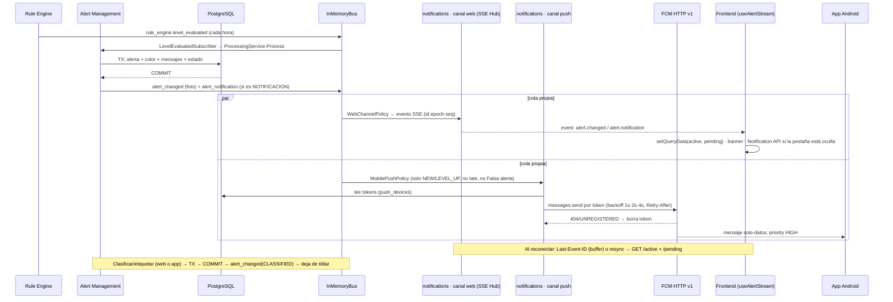

# Plan: módulo de notificaciones (Fase 0, análisis)

Módulo de notificaciones de extremo a extremo:

- Alert Management publica eventos de dominio.
- El módulo de notificaciones los reparte por dos canales: web en tiempo real (SSE) y móvil (FCM HTTP v1).
- El frontend los aplica de inmediato al mapa, al banner y al panel.

> ⚠️ **Bloqueante antes de aprobar.** Se acordó **no editar `backend/`**, porque es de otro integrante del equipo. Este plan toca bastante backend, incluido `alert_management`, que es su módulo. Hay que confirmar que hay autorización, o definir qué parte se hace aquí y cuál se le pasa a él (pregunta 1 de "Preguntas pendientes").

---

## 1. Hallazgos

### Alert management: existe y está maduro
- **Entidades** ([alert.go](../backend/internal/modules/alert_management/domain/entities/alert.go)):
  - `Alert`: estado, nivel actual y máximo, `Runtime` y `Management`.
  - `Segment`: los "colores" de la alerta, en `alert_level_segments`.
  - `Message`: la línea de tiempo, en `alert_messages`.
  - `Observation`, `ProcessingState` y `Policy` versionada.
- **Estados**:
  - `ACTIVA ⇄ FINALIZADA`. Vuelve a `ACTIVA` por reactivación.
  - Gestión: `SIN_CLASIFICAR → CLASIFICADA_SIN_ETIQUETA → CLASIFICADA_CON_ETIQUETA`. Solo avanza, y un trigger en la BD lo garantiza.
  - Niveles: `NORMAL < AMARILLO < NARANJA < ROJO`.
- **Transiciones**: la función pura `Decide` devuelve `OPENED`, `REACTIVATED`, `UPDATED` (sube, baja o sin datos) y `FINISHED`. La clasificación y la etiqueta van aparte, en `ManagementService`.
- **¿Una escalada es la misma alerta?** **Sí.** Subir o bajar de nivel abre un color nuevo en la misma alerta, con el mismo `id`.
  - La reactivación dentro de 24 h, si la alerta sigue sin clasificar, también conserva el `id`.
  - Se crea una alerta nueva, con otro `id`, si la anterior ya estaba clasificada (`NEW_AFTER_CLASSIFIED`) o si pasaron 24 h o más (`OPEN`).
  - No hay un "episodio" como entidad. El único vínculo es `alert_processing_state.last_alert_id`.
- **Ya publica eventos después del commit**: `alert_management.alert_notification` ([contract](../backend/internal/modules/alert_management/contract/alert_notification.go), `schema_version 1`).
  - Sale un evento por cada mensaje `NOTIFICACION` nuevo: apertura, subidas y reactivación que supera el máximo.
  - Lleva `message_id` (clave de idempotencia), `late`, `title` y `body`.
  - **Hoy no tiene suscriptores.** El README del módulo ya dice que el canal web/push y los reintentos son del módulo de notificaciones.
- **No publica nada en estos casos**:
  - Bajadas de nivel (`DOWNGRADE`).
  - Fin de la alerta (`END_NORMAL`).
  - Sin datos (`NO_CALC_START/END`).
  - **Clasificación y etiqueta**: `ManagementService` ni siquiera tiene un publicador.
  - Por eso, hoy la web no se enteraría de que un marcador rojo debe dejar de titilar.
- **Falta un dato que pide el contrato FCM**: `AlertNotification` no trae la clasificación, y el contrato exige no enviar push de alertas con *Falsa alerta*. Un test lo confirma: una falsa alerta "sigue notificando".

### Event bus y tiempo real
- **Ya existe un bus**: `shared/eventbus` tiene la interfaz `Bus` y la implementación `InMemoryBus`.
  - Cada suscripción tiene su propia cola y su propio worker, con orden FIFO.
  - Atrapa los pánicos (`recover`) y corta por `handlerTimeout` (30 s).
  - Si la cola se llena descarta el evento más viejo (`DropOldest`, cola de 256).
  - **Ya da el aislamiento entre canales que pide el requisito.**
- **Reglas de aislamiento** (con `depguard` en `.golangci.yml`):
  - Un módulo consumidor no importa el `contract/` del publicador.
  - La traducción entre tipos y las suscripciones viven en `internal/bootstrap`.
  - `alert_management` no puede importar el bus.
- **No hay nada de tiempo real**: ni WebSocket, ni SSE, ni `http.Flusher`, en backend ni en frontend.
- `backend/internal/modules/notifications/` existe, pero solo tiene un `README.MD` vacío.

### Router, wiring y configuración
- **El entrypoint real es [cmd/platform/main.go](../backend/cmd/platform/main.go)**, que es el que compila el Dockerfile.
  - Usa `ServeMux` con los patrones de Go 1.22 (`"GET /api/alerts/{id}"`).
  - Cada módulo registra sus rutas con `RegisterRoutes(mux)`, y todo se envuelve en `WithCORS`.
  - Los módulos se arman en [application.go](../backend/internal/bootstrap/application.go) según `AGATHA_MODULES` ([modules.go](../backend/internal/bootstrap/modules.go)), que valida las dependencias entre ellos.
- `cmd/api/main.go` es un entrypoint viejo: solo levanta Dashboard. No se toca.
- **Configuración**:
  - `godotenv` carga el `.env` en `NewPlatform`.
  - Cada módulo lee su propia variable de entorno, con un valor por defecto si falta.
  - **No existe `backend/.env.example`**. El `.dockerignore` excluye `.env*`.
- **No hay autenticación en ningún endpoint.** El origen viene del cuerpo (RN-10).

### Frontend
- **El mapa, el panel y el toast todavía usan el modelo temporal `services/alerts`**, con `emptyAlerts.adapter`, que no devuelve datos.
  - `usePilotNodes` → `usePendingAlerts` (polling cada 30 s).
  - `RecentAlertsPanel` → `useRecentAlerts` y `usePendingAlerts`.
  - `NewAlertToast` → `useNewAlerts`: un estado a nivel de módulo que compara los ids de la lista "recientes".
  - `useDevices` hace polling cada 60 s.
- **Query keys**: `alertKeys` (`all`, `recent`, `pending`, `histories`, `management(id)`). No existe una key para `active`.
- **Ya consume la API real**: el historial y el modal de gestión, con `services/alertManagement` y la actualización fina de caché en `useAlertManagementMutations`.
- **El aviso gris se calcula en el cliente** a partir de `device.lastConnection`: más de 120 min sin datos es "sin comunicación".
- **El mapa ya está optimizado**: los íconos se cachean por `tone|warning|blinking`, así que cambiar un nodo no redibuja los demás.

### Riesgos e inconsistencias que afectan este trabajo
1. **El `ReadTimeout: 15s` de `cmd/platform`** cancela el contexto de una conexión larga a los 15 s, por la lectura de fondo de `net/http`. El handler del stream debe limpiar los deadlines con `http.ResponseController`.
2. **`docker-compose.yml` fija `AGATHA_MODULES` sin `alert_management`.** En el VPS no hay alertas y, por lo tanto, no habría notificaciones.
3. **CORS solo permite `GET`** (`corsAllowedMethods = "GET"`). El stream SSE funciona igual. Pero los `POST` de clasificación desde el frontend desplegado fallan en el preflight; en desarrollo no se nota porque el proxy de Vite lo oculta. El móvil no se ve afectado, porque CORS no aplica fuera del navegador.
4. **El HTTPS es autofirmado sobre una IP** (`129.213.118.230`). Desde Vercel, el navegador rechaza tanto `fetch` como `EventSource`. Además, el proxy del VPS (¿nginx?) no está en el repo: para SSE necesita `proxy_buffering off` y un `proxy_read_timeout` mayor que el heartbeat.
5. **El bus pierde eventos si el proceso se cae** entre el commit y la publicación. En la web lo cubre la resincronización por REST. En el push, ese aviso se perdería. La fuente de verdad sigue siendo `alert_messages` (`kind = NOTIFICACION`), que funciona como un outbox natural para conciliar más adelante.
6. **Datos del contrato FCM que no coinciden con el backend**:
   - `alertId`: el ejemplo usa `ALR-0142`, pero el código real es `ALR-000142`.
   - `pk`: debe ser la abscisa (`12+350`), pero el backend solo tiene `devices.name` ("Sensor …").
   - Los enums están en español (`AMARILLO`, `FUGA`) y la app espera inglés (`YELLOW`, `LEAK`). Hay que mapearlos.
7. **El backend no modela un "aviso gris" por dispositivo.** Solo hay mensajes `NO_CALC_*` dentro de una alerta activa, y horas `NO_CALCULABLE` en `rule_engine.level_evaluated`.
8. **El banner detecta "nuevas" por id de alerta.** Un `LEVEL_UP` conserva el id, así que hoy no aparecería.
9. **Un test de alertas exige que no existan `/api/alerts/push-devices` ni `/api/alerts/notifications`.** El registro de tokens tiene que ir fuera de `/api/alerts`, y la ruta del contrato ya lo está.
10. **Endpoints abiertos**: sin autenticación, cualquiera podría registrar un token y recibir alertas, o abrir el stream. Habría que aceptarlo para el piloto, con límites de tamaño.
11. **Límite de conexiones del navegador**: con HTTP/1.1 se permiten 6 por origen. Muchas pestañas abiertas agotarían las conexiones; HTTP/2 en el proxy lo evita.

---

## 2. Decisiones recomendadas

### Decisión 1. Transporte web: **Server-Sent Events**

| | SSE | WebSocket |
|---|---|---|
| Dirección | Servidor → cliente, que es el caso | Bidireccional, y no se necesita |
| Dependencias en Go | Ninguna (`http.Flusher` de la stdlib). El proyecto evita dependencias: el Excel se hizo solo con stdlib | Requiere `coder/websocket` o `gorilla` |
| Reconexión | Nativa en `EventSource`, con `retry:` y reenvío de `Last-Event-ID` | A mano |
| Proxy y HTTPS | HTTP normal; pasa por nginx con `proxy_buffering off`; aprovecha HTTP/2 | Exige el `Upgrade` en el proxy |
| CORS y auth | GET simple con el CORS actual. Contra: `EventSource` no envía cabeceras, así que un token futuro iría en cookie o query | Mismo problema de cabeceras |
| Límite | 6 conexiones por origen en HTTP/1.1 | No tiene ese límite |

**Recomendación: SSE.** El flujo es unidireccional y el estándar ya trae la reconexión y el reenvío por id. No agrega dependencias y es lo más simple de explicar y defender.

Para no perder eventos se usan tres mecanismos juntos:
- **Ids de evento**: el hub numera cada evento como `<epoch>-<seq>` y guarda los últimos 256 en un buffer circular. Al reconectar, el navegador envía `Last-Event-ID` y el servidor le reenvía lo que faltó. Si el id no está en el buffer o cambió el epoch (el servidor se reinició), le manda `event: resync`.
- **Resincronización por REST en cada reconexión**: el cliente vuelve a pedir `/active` y `/pending`. Es la fuente de verdad.
- **Heartbeat**: un comentario `: ping` cada 25 s. El cliente reconecta si pasan 60 s sin recibir nada.

### Decisión 2. Event bus: **reutilizar `shared/eventbus`; no crear otro**
- El puerto ya existe: `Bus` del lado técnico, y `ports.NotificationPublisher` del lado de dominio.
- Los publicadores dependen solo de sus puertos. Los suscriptores son structs con `Handle(ctx, Notice)`. Solo `bootstrap` conoce el bus.
- **Cambio futuro a outbox o broker**: se cambia el adaptador en `bootstrap` (`busAlert…Publisher`) y cómo se registran los suscriptores, sin tocar publicadores ni consumidores.
- Matiz: un outbox *transaccional* requiere escribir dentro de la transacción. Lo más barato sería un "conciliador" que lea `alert_messages.id > último_enviado`, porque esa tabla ya cumple ese papel.
- **Aislamiento de canales**: cada canal es una suscripción distinta al bus, con su propia cola y su propio worker (`notifications.alert_notification.web` y `notifications.alert_notification.push`). Si FCM tarda, solo se atrasa su cola; ni el canal web ni la gestión de alertas lo notan.

### Decisión 3. Catálogo de eventos
Los dos tópicos los publica `alert_management`, siempre después del commit:

| Tópico | Cuándo | Lo consume |
|---|---|---|
| `alert_management.alert_notification` (existe; v1 + campos compatibles `classification` y `started_at`) | Cada mensaje `NOTIFICACION` nuevo | Push (FCM) y banner web |
| **`alert_management.alert_changed`** (nuevo, v1) | Cualquier cambio visible de una alerta. `change` ∈ `OPENED`, `LEVEL_RAISED`, `LEVEL_LOWERED`, `REACTIVATED`, `FINISHED`, `NO_DATA_STARTED`, `NO_DATA_ENDED`, `CLASSIFIED`, `LABELED` | Canal web (mapa y panel) |

- **Payload de `alert_changed`**: es una foto del estado.
  - Campos: `alert_id`, `alert_code`, `measuring_point_id`, `event_type`, `change`, `state`, `current_level`, `max_level`, `blinking`, `management_status`, `classification` y `started_at`.
  - Además, `evaluated_at` (el reloj del procesamiento), `occurred_at` y `schema_version`.
- **Por qué un tópico con discriminador y no 9 tópicos**:
  - Al cliente le basta con un reducer del tipo "aplicar la foto si es más nueva".
  - `change` conserva la semántica de dominio para los logs y la UI.
  - Se aparta de la regla "eventos con referencias, no datos", y se justifica así: evita N consultas REST por evento, y la foto es pequeña.
- **Cómo el cliente descarta duplicados y eventos viejos**, sin columna nueva en la BD:
  - Los campos de **nivel y estado** solo se aplican si `evaluated_at` es mayor que el que está en caché. El orden está garantizado: el lock por punto procesa las horas en orden y descarta las repetidas.
  - Los campos de **gestión** solo se aplican si el rango de `management_status` es mayor, porque la gestión solo avanza.
  - `blinking` se recalcula en el cliente con `ACTIVA ∧ ROJO ∧ sin clasificar`.
  - Las notificaciones se deduplican por `message_id`.
- **`DeviceNoticeChanged` (aviso gris)**: no existe en el backend. Propuesta: mantener el cálculo actual en el cliente (`lastConnection` + `useNow`) y que `alert_changed` con `NO_DATA_*` cubra el caso "Alerta + aviso". Un evento de dispositivo queda para después (pregunta 4).

**Mapeo al push FCM** (estrategia `MobilePushPolicy`):
- **`kind`**:
  - `OPEN` y `NEW_AFTER_CLASSIFIED` → `NEW`.
  - `UP_*` y `REACTIVATED` → `LEVEL_UP`.
- **Se descarta y no se envía** si:
  - `late = true`.
  - `classification = FALSA_ALERTA`.
  - El nivel no es Amarillo, Naranja ni Rojo.
  - El código es desconocido.
- **Formato del mensaje**:
  - Niveles: `AMARILLO/NARANJA/ROJO` → `YELLOW/ORANGE/RED`. Eventos: `FUGA` → `LEAK`.
  - Todos los valores van como string, con `android.priority = HIGH` y sin bloque `notification`.

---

## 3. Flujo del evento

---

## 4. Archivos

**Backend.** `N` = nuevo, `M` = modificado. Los archivos de `notifications/` están bajo `backend/internal/modules/notifications/`.

| Ruta | | Qué cambia y por qué |
|---|---|---|
| `alert_management/contract/alert_notification.go` | M | Agrega `Classification` y `StartedAt` (campos compatibles, v1). La regla "no enviar Falsa alerta" los necesita |
| `alert_management/contract/alert_changed.go`, `topics.go` | N/M | `AlertChanged` + `TopicAlertChanged` |
| `alert_management/application/ports/ports.go` | M | Puerto `AlertChangePublisher` |
| `alert_management/application/services/processing_service.go` (+test) | M | Junta los cambios dentro de la TX y los publica después del commit (backfill no publica) |
| `alert_management/application/services/management_service.go` (+test) | M | Publica `CLASSIFIED`/`LABELED` después del commit, solo cuando el resultado es `SAVED` |
| `alert_management/ALERT_MANAGEMENT_README.MD` | M | Documenta el nuevo tópico |
| `bootstrap/alert_management.go` | M | Adaptadores hacia el bus para los dos tópicos |
| `bootstrap/notifications.go` (+`_test.go`) | N | Wiring, traducción contrato→Notice, suscripciones con nombre y prueba de punta a punta con el bus real |
| `bootstrap/modules.go`, `application.go`, `modules_test.go` | M | `ModuleNotifications` (requiere `alert_management`) |
| `cmd/platform/main.go` | M | Solo el comentario con la lista de módulos |
| `notifications/domain/entities/*.go` | N | `AlertNotice`, `AlertChange`, `PushDevice`, enums `PushKind`, `PushLevel` |
| `notifications/domain/policies/*.go` (+tests) | N | **Strategy**: `ChannelPolicy` + `MobilePushPolicy`, `WebPolicy` |
| `notifications/application/ports/*.go` | N | `PushTokenRepository`, `PushSender`, `RealtimeBroadcaster`, `Clock` |
| `notifications/application/services/*.go` (+tests) | N | `PushTokenService` (upsert), `MobilePushService` (filtro → envío a todos los tokens → reintentos → limpieza), `WebRealtimeService` |
| `notifications/infrastructure/events/*.go` | N | Subscribers + Notices propios (**Observer**) |
| `notifications/infrastructure/fcm/*.go` (+tests) | N | **Adapter** `HTTPV1Sender` (OAuth2 con la cuenta de servicio), constructor del mensaje según el contrato, backoff, `NoopSender` si no hay credencial |
| `notifications/infrastructure/fcm/fcmtest/fake_sender.go` | N | Sender falso que graba lo enviado o devuelve errores programados |
| `notifications/infrastructure/realtime/*.go` (+tests) | N | **Adapter** `SSEHub` (clientes, buffer circular, heartbeat, descarta clientes lentos) + `StreamHandler` |
| `notifications/infrastructure/http/push_token_handler.go` (+test) | N | `PUT /api/devices/push-token` |
| `notifications/infrastructure/http/test_event_handler.go` | N | `POST /api/notifications/test-event`, solo fuera de producción y con un flag |
| `notifications/infrastructure/persistence/{schema,models,mappers,repositories}` | N | Tabla `push_devices` + `Migrate` idempotente |
| `notifications/README.MD` | M | Documentación del módulo (hoy está vacío) |
| `.golangci.yml` | M | Regla `notifications-isolation` (no importa `alert_management` ni el bus) |
| `go.mod` / `go.sum` | M | `golang.org/x/oauth2` (tokens de la cuenta de servicio). Se evita el Firebase Admin SDK, que es pesado; con HTTP directo el sender falso es trivial |
| `.env.example` | N | `FCM_*`, `NOTIFICATIONS_*` con valores de ejemplo, sin secretos |
| `docker-compose.yml` | M | Agregar `alert_management,notifications` a `AGATHA_MODULES` (pregunta 8) y montar el secreto en solo lectura |
| `shared/eventbus/README.md` | M | Catálogo de eventos actualizado |

**Frontend** (todo bajo `frontend/src/`):

| Ruta | | Qué cambia y por qué |
|---|---|---|
| `services/alertManagement/{types,service,http}.ts` (+test) | M | `getActive()` y `getPending()` con los tipos `ActiveResponse` y `PendingResponse` |
| `services/alerts/*` | **Eliminado** | Modelo temporal con adaptador vacío |
| `services/http/httpClient.ts` | M | Exportar `apiUrl()` para que `EventSource` use la misma URL base |
| `services/realtime/alertStream.{types,client}.ts` (+test) | N | Contrato de los eventos web y wrapper de `EventSource`: backoff con jitter, watchdog de 60 s, reconexión manual cuando `readyState = CLOSED` |
| `features/alerts/hooks/alertKeys.ts` | M | Agrega `active()` |
| `features/alerts/hooks/useAlerts.ts` | M | `useActiveAlerts` y `usePendingAlerts`. **El polling solo se activa si el stream está caído** |
| `features/alerts/hooks/useAlertStream.ts` | N | Conexión única (singleton) + `useSyncExternalStore` para el estado; aplica los eventos a la caché |
| `features/alerts/lib/streamCache.ts` (+test) | N | Reducers puros: `applyAlertChanged(active)`, `applyAlertChanged(pending)`, reglas de "más nuevo" |
| `features/alerts/lib/newAlerts.ts` (+test) | M | El banner se alimenta del stream, con clave `messageId` (cubre `LEVEL_UP`) |
| `features/alerts/lib/browserNotification.ts` | N | Notification API: solo con permiso y con la pestaña oculta |
| `features/alerts/components/{NewAlertToast,RecentAlertsPanel,AlertListItem}.tsx` | M | Pasan al modelo `AlertItem`/`AlertLevel` |
| `features/alerts/components/RealtimeStatus.tsx` | N | Indicador de conexión (En vivo / Reconectando / Sin conexión) + botón para activar las notificaciones del navegador |
| `features/alerts/config/alertDisplay.ts` (+test) | M | `SEVERITY_STYLES` indexado por `AlertLevel` |
| `features/map/hooks/usePilotNodes.ts`, `lib/nodeState.ts` (+test) | M | Usan `/active` (`level`, `blinking`); el gris se queda en el cliente |
| `app/RootLayout.tsx`, `components/layout/Header.tsx` | M | Montar `useAlertStream` una sola vez y mostrar el indicador |
| `docs/CONTRATO_PUSH_FCM.md` | M | Ruta y valores finales (`alertId`, `pk`) para el equipo móvil |

---

## 5. Plan de commits

Se trabaja un commit a la vez: se hacen los cambios, se revisan y se hace el commit antes de pasar al siguiente. Los mensajes van en inglés (Conventional Commits).

**Fase 1: base del backend**
- [ ] 1. `feat(alert-management): add classification and start time to alert notification event`
- [ ] 2. `feat(alert-management): publish alert_changed after hourly processing commits`
- [ ] 3. `feat(alert-management): publish alert_changed after classification and labeling`
- [ ] 4. `feat(notifications): add domain model and channel policies`
- [ ] 5. `feat(bootstrap): wire notifications module and event subscriptions`

**Fase 2: canal web**
- [ ] 6. `feat(notifications): add SSE hub with heartbeat and replay buffer`
- [ ] 7. `feat(notifications): expose realtime alert stream endpoint`

**Fase 3: canal FCM**
- [ ] 8. `feat(notifications): persist push device tokens`
- [ ] 9. `feat(notifications): add push token registration endpoint`
- [ ] 10. `feat(notifications): add FCM HTTP v1 sender with service account auth`
- [ ] 11. `feat(notifications): deliver mobile push with retries and token cleanup`
- [ ] 12. `chore(backend): add env example with notification settings`
- [ ] 13. `feat(notifications): add dev-only endpoint to emit test events`

**Fase 4: frontend**
- [ ] 14. `feat(alerts): add active and pending endpoints to alert management service`
- [ ] 15. `refactor(alerts): migrate map and alert panel to alert management API`
- [ ] 16. `refactor(alerts): remove temporary alerts service`
- [ ] 17. `feat(realtime): add alert stream client with reconnection and watchdog`
- [ ] 18. `feat(alerts): apply stream events to query cache and pause polling while live`
- [ ] 19. `feat(alerts): drive new alert banner from stream notifications`
- [ ] 20. `feat(alerts): show browser notifications when tab is hidden`
- [ ] 21. `feat(layout): add realtime connection indicator`

**Fase 5: pruebas y documentación**
- [ ] 22. `test(bootstrap): cover alert to web and push delivery end to end`
- [ ] 23. `docs(notifications): document module, event catalog and FCM contract`

---

## 6. Estrategia de pruebas

**Backend (unitarias)**
- `MobilePushPolicy` (tabla de casos):
  - `OPEN` → `NEW`, `UP_ROJO` → `LEVEL_UP`.
  - `late`, `FALSA_ALERTA`, `NORMAL` o un código desconocido → no se envía.
- `WebPolicy`: deja pasar todo.
- Constructor del mensaje FCM: todos los valores string, `priority HIGH`, sin `notification`, mapeo de enums y campos opcionales omitidos.
- Backoff:
  - Con un reloj falso: reintenta en 429/5xx/red, respeta `Retry-After` y para en el máximo de intentos.
  - No reintenta en 400.
- Limpieza: un `httptest.Server` que simula FCM con 404/`UNREGISTERED` → el token se borra.
- Hub SSE:
  - Reparte a varios clientes y descarta al cliente lento sin bloquear a los demás.
  - Heartbeat.
  - `Last-Event-ID` dentro del buffer reenvía lo pendiente; fuera del buffer o con otro epoch manda `resync`.
- `StreamHandler`: cabeceras, flush, cierre al cancelar el contexto y sin corte a los 15 s.
- Publicador (alert management): "commit → publica" y "rollback → no publica", siguiendo el checklist del README del bus.
- `PushTokenService`: el upsert es idempotente y un token repetido en otro `deviceId` se reasigna.

**Sender falso**: `fcmtest.FakeSender` graba los mensajes y permite programar errores por token. Se usa en `MobilePushService` y en la prueba de punta a punta.

**De punta a punta (`bootstrap`, con el bus real)**: Processing → Rule Engine → Alert Management → notifications. Verifica que el `FakeSender` reciba solo `NEW`/`LEVEL_UP` y que un grabador del hub reciba `alert.changed`, incluido `CLASSIFIED`.

**Frontend (vitest, solo funciones puras)**: `streamCache` (aplicar, ignorar lo viejo, quitar de pendientes al clasificar), `newAlerts` con `LEVEL_UP`, backoff del cliente y parseo de eventos.

**Prueba manual**
1. Levantar el backend con `alert_management,notifications` y `NOTIFICATIONS_TEST_ENDPOINT=true`.
2. Ver el stream: `curl -N http://localhost:8080/api/notifications/stream`.
3. Disparar un evento: `curl -X POST .../api/notifications/test-event -d '{"level":"ROJO","kind":"NEW","measuring_point_id":…}'`. Recorre el mismo pipeline del bus.
4. En la web: el marcador cambia, aparece el banner y, con la pestaña oculta, la notificación del navegador.
5. En el celular: registrar el token desde la app (o con `curl -X PUT .../api/devices/push-token`) y repetir el paso 3.
6. Probar la reconexión: reiniciar el backend y comprobar que el indicador pasa a "Reconectando" → "En vivo" y que se resincroniza.

---

## 7. Preguntas pendientes

1. **Backend**: ¿hay autorización del responsable del backend para tocar `backend/`, sobre todo `alert_management` (commits 1-3)? Si no la hay, esos commits se preparan como propuesta o issue para él y se avanza con el frontend contra el contrato acordado.
2. **`alertId` en el push**: ¿se manda el código `ALR-000142` (recomendado, porque `GET /api/alerts/{id}` lo acepta) o el id numérico?
3. **`pk`**: ¿se saca la abscisa de `devices.name` en el backend (igual que `extractPk` del frontend) o se omite? Es opcional en el contrato.
4. **Aviso gris**: ¿se mantiene en el cliente (`lastConnection`) para esta entrega, o se agrega un evento de dispositivo a partir de las horas `NO_CALCULABLE` del Rule Engine?
5. **Credencial FCM**: ¿un archivo montado (`FCM_SERVICE_ACCOUNT_FILE`, recomendado con Docker) o el JSON en base64 en una variable (`FCM_SERVICE_ACCOUNT_JSON_BASE64`)? Se pueden soportar los dos, con prioridad para el archivo.
6. **Ruta de registro**: ¿se deja tal cual el contrato (`PUT /api/devices/push-token`, 204, `platform = ANDROID`)? Se recomienda no cambiarla para no tocar la app.
7. **Horas atrasadas (`late`)**: ¿se confirma que no van al push, como dice la especificación, pero sí a la web?
8. **Despliegue**: ¿se agrega `alert_management,notifications` al `docker-compose.yml`? ¿Quién administra el proxy HTTPS del VPS, para pedirle `proxy_buffering off`?
9. **Seguridad**: ¿se aceptan el stream y el registro de tokens sin autenticación durante el piloto (con límites de tamaño), igual que `/api/alerts`?
10. **Permiso del navegador**: ¿se pide con un botón en el indicador (recomendado) o al cargar la app?
11. **CORS solo `GET`**: ¿se incluye la corrección como un commit aparte o se le reporta al responsable del backend?
